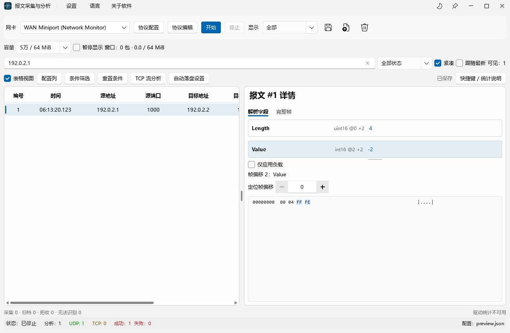
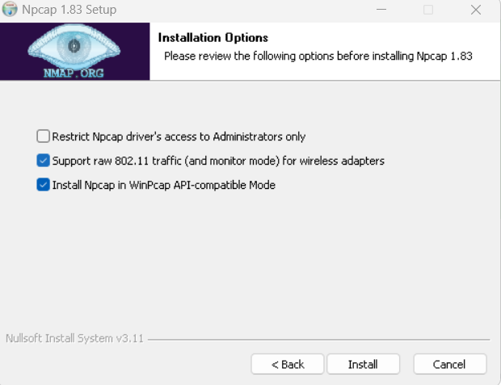

# PacketCaptureTool

[简体中文](README.md) | [English](README.en.md)

基于 Qt 6 / QML 和 C++17 的网络报文采集与自定义协议分析工具。支持实时采集、PCAP/PCAPNG 离线读取、JSON 字段解析、TCP 流重组及自动轮转归档，适合设备通信调试与二进制协议验证。

文档更新：2026-10-11，以当前源码行为为准。

## 软件预览



截图使用自动化测试的合成报文演示布局，实际字段、计数及语言取决于当前会话。界面支持简体中文 / English 即时切换、浅色 / 深色主题，以及网卡、列布局和分析显示偏好恢复。

## 主要功能

| 功能 | 当前支持 |
| --- | --- |
| 实时采集 | 选择网卡、开始/停止、继续当前会话，查看驱动接收与丢包统计 |
| 离线分析 | 后台读取 PCAP/PCAPNG、显示已读取包数、取消导入；失败或超限保留原会话 |
| 自定义协议 | 一份 TCP 或 UDP JSON 配置，按源/目标端口匹配，固定长度或长度字段校验 |
| 字段解析 | 有/无符号 8–64 位整数、float32/float64、UTF-8 字符串、bytearray、大小端 |
| 字段扩展 | 无符号整数位域、整数枚举、比例、偏置、单位显示 |
| 协议编辑器 | 表单 / JSON / Hex 预览、高级属性、保存 JSON、应用草稿并重新解析 |
| TCP 流分析 | 当前内存快照双向重组，处理拆包、粘包、重传和乱序，固定/长度字段分帧及缺包诊断 |
| 分析视图 | 表格/卡片、搜索、状态筛选、AND/OR 条件、排序、自定义字段列及字段右键筛选 |
| 字节定位 | 字段与 Hex 双向定位、仅负载显示、可调整字段/Hex 高度、复制纯 Hex 字节 |
| 数据保存 | 手动保存当前窗口全部报文为 PCAP；自动落盘按大小/时间/链路类型轮转 |
| 桌面集成 | 应用图标、系统托盘、即时中英文切换、关于软件及可迁移的设置目录 |

## 快速使用

1. 运行完整部署目录中的 `PacketCaptureTool.exe`。
2. 如需英文界面，点击 **语言 → English**。
3. 点击 **协议编辑 → 导入 JSON**，打开 [扩展字段示例](docs/extended_fields_example.json)，在 **Hex 预览** 输入 `3F C0 00 00 21`，点击 **验证与预览**。预期电压为 `4 V`，状态位域为 `2`（就绪），原始标志为 `33`。
4. 停止采集时点击 **应用草稿**，或使用 **协议配置** 直接加载自己的 JSON。
5. 选择实际承载通信的网卡，点击 **开始**；也可按 `Ctrl+O` 打开 PCAP/PCAPNG。
6. 选择报文查看字段、错误和 Hex。TCP 消息跨段或同段含多条消息时，使用 **TCP 流分析**。
7. 点击 **停止**，按 `Ctrl+S` 保存当前内存窗口；另行保存协议 JSON。

详细步骤、配置参考、统计口径及故障排查见 [中文用户使用手册](docs/user_manual.md) / [English user manual](docs/user_manual.en.md)。

## 使用时需要了解的行为

- **显示筛选**：UDP/TCP/全部、状态、搜索与结构化条件影响可见列表，不删除底层报文。条件中的字段比较及排序使用原始解析值；比例、偏置与枚举影响显示。
- **暂停显示**：采集、内存保留和自动落盘继续；恢复显示后补齐当前窗口。
- **会话与保存**：开始保留已有数据，停止后可继续；导入成功替换会话。保存会先停止采集，输出当前窗口全部原始报文，包括被筛选隐藏的包。清空、导入和退出会检查未保存报文。
- **容量**：1 万包 / 16 MiB、5 万包 / 64 MiB（默认）、10 万包 / 128 MiB。MiB 仅计算原始报文，实际进程内存还有解析与界面开销。未启用自动落盘时达到任一上限会停止采集；离线文件超限会整次拒绝导入。
- **自动落盘**：停止、保存并清空会话后启用。内存滚动移出已安全归档的旧包，完整记录位于归档目录。文件不会覆盖或自动删除，最多文件数按每次任务计算；队列满、写入失败或达到文件上限会停止采集。重启后需重新启用。
- **TCP 边界**：逐包解析检查 TCP 段负载，独立流分析才重组业务消息。流分析假设窗口中每方向首段从消息边界开始；最多 5 万匹配段 / 16 MiB、128 连接、1000 消息 / 4 MiB，每消息展示前 64 字段及前 512 字节 Hex。
- **当前范围**：不自动解密 TLS，不按协议名称加载应用协议库；尚无多协议自动识别、可配置 CRC、动态数组/嵌套结构、完整 IP 分片重组或 PCAPNG 导出。

## JSON 协议配置

字段 `offset` 从应用负载或单条重组消息第 0 字节计数，不包含网络首部。`port` 匹配源或目标端口，不会创建监听服务。以下是独立演示配置，并非 `docs/test.json` 的副本：

```json
{
  "protocolName": "DemoUDP",
  "transportType": "UDP",
  "port": 8080,
  "length": { "type": "fixed", "fixedValue": 6 },
  "fields": [
    { "name": "MessageType", "offset": 0, "length": 2, "type": "uint16", "endianness": "big" },
    { "name": "Value", "offset": 2, "length": 4, "type": "int32", "endianness": "big" }
  ]
}
```

用 `00 01 FF FF FF FE` 预览，结果为 `MessageType=1`、`Value=-2`。可变长度模式写为 `"length": { "type": "variable", "fieldName": "TotalLength" }`，并在 `fields` 中定义同名无符号整数字段；其原始值表示整条消息长度，包含长度字段自身，不能使用位域。

完整校验规则和高级字段示例见 [手册配置参考](docs/user_manual.md#协议配置完整参考)。示例文件当前参数：

| 文件 | 传输 / 端口 | 完整负载长度 |
| --- | --- | ---: |
| [extended_fields_example.json](docs/extended_fields_example.json) | UDP / 8080 | 5 字节 |
| [tcp_stream_example.json](docs/tcp_stream_example.json) | TCP / 443 | 43 字节 |
| [test.json](docs/test.json) | UDP / 53744 | 347 字节 |

示例可能随调试修改，使用前检查实际 JSON；TCP 示例的名称 `TCP4ByteMessage` 不代表当前长度为 4。

## 系统托盘、语言与设置目录

默认点击窗口关闭按钮会收起到托盘，采集和归档继续。单击/双击托盘显示主窗口，右键可开始/停止采集或退出。真正退出请使用 **设置 → 退出软件** 或托盘菜单；可在设置中关闭 **关闭窗口时收起到托盘**。系统不支持托盘时正常执行退出流程。重新构建前应真正退出，以免 EXE/DLL 被锁定。

**语言** 菜单即时切换简体中文和 English 并记住选择，协议字段名与枚举标签保持 JSON 原文。Windows 中文优先使用微软雅黑，英文优先使用 Segoe UI，Hex 保持等宽字体。**关于软件** 显示构建版本、作者 Rookie、版权及项目链接。

**设置 → 配置文件存放目录…** 可查看、更换或打开 `settings.ini` 所在目录。默认使用 Qt 用户应用配置目录（Windows 通常为 `%LOCALAPPDATA%/PacketCaptureTool/Packet Capture Tool`），以弹窗路径为准。更换目录迁移当前设置并立即生效，原文件保留，目标已有不同设置时拒绝覆盖。协议 JSON 打开/保存默认使用该目录，但已有协议和抓包文件不会自动搬移。

## 构建与测试（Windows）

### 依赖

- C++17 编译器、CMake 3.16+、Git 2.0+，使用 Git 克隆的工作目录（配置会检查 Git 仓库）。
- Qt 6.4+，安装与编译器及位数匹配的套件，包含 Core、Gui、Widgets、Network、Qml、Quick、QuickControls2、QuickDialogs2、PrintSupport、Test、LinguistTools；测试目标默认参与构建。
- Windows 实时采集需要安装 Npcap 驱动；仓库中的 `3rdparty/npcap-sdk-1.15` 是编译 SDK，不能替代驱动。驱动安装入口见 [Npcap 官网](https://npcap.com/#download)，安装设置示意见下图。
- CMake 使用 FluentUI `main` 与 PcapPlusPlus `v25.05`。首次配置会拉取到 `3rdparty/gitrep/`，需要网络；已有 `.git` 的依赖目录会复用本地源码。



### 配置、编译和运行

以下 PowerShell 示例使用 Qt MinGW 套件和 Ninja。将路径改为本机实际安装位置，并先把该套件配套的 MinGW 编译器、Qt `bin` 和 Ninja 加入 `PATH`：

```powershell
git clone https://github.com/RookieLinux/PacketCaptureTool.git
cd PacketCaptureTool
cmake -S . -B build -G Ninja -DCMAKE_BUILD_TYPE=Release -DCMAKE_PREFIX_PATH="D:/Qt/6.6.2/mingw_64" -DWINDEPLOYQT_EXECUTABLE="D:/Qt/6.6.2/mingw_64/bin/windeployqt.exe"
cmake --build build --parallel 4
ctest --test-dir build --output-on-failure
.\build\PacketCaptureTool.exe
```

Ninja / MinGW Makefiles 等单配置生成器通常将 EXE 放在构建目录；多配置生成器通常使用 `Release` 子目录，运行路径应以实际生成器为准。不要在同一构建目录混用不同编译器、Qt 套件或生成器。

构建脚本在设置 `WINDEPLOYQT_EXECUTABLE` 时调用 windeployqt，并复制 FluentUI QML 模块及第三方 DLL。分发时复制完整部署目录，保留 Qt DLL、`platforms`、`qml` 等目录。应用内英文翻译由 LinguistTools 编译并嵌入资源。

已有 `cmake-build-release` 时也可运行：

```powershell
cmake --build cmake-build-release --parallel 4
ctest --test-dir cmake-build-release --output-on-failure
```

测试套件包括 `PacketCaptureTests`、`ConfigurationLoaderTests`、`ProtocolValidationTests`、`TcpStreamTests`、`QmlInterfaceTests`。界面测试采用 offscreen / software 后端；自动化测试覆盖不等于实际网卡长期高吞吐验收。

## 项目结构与架构

```text
.
├── 3rdparty/       # Npcap SDK、第三方源码及运行库
├── cmake/          # Git 检查、依赖获取、构建辅助
├── docs/           # 中英文手册、示例、首部对照及截图
├── src/
│   ├── backend/    # 采集、归档、解析、流重组、模型、设置及桌面集成
│   ├── ui/         # QML 主界面、编辑器、分析与 Hex 视图
│   ├── i18n/       # 英文翻译源文件 app_en.ts
│   └── resources/  # SVG、PNG、ICO 和 Windows 图标资源
├── tests/          # Qt Test 自动化验证
├── tools/          # 图标生成工具
└── CMakeLists.txt
```

QML 负责交互展示，`CaptureController` 协调会话和后台任务，`PacketModel` 提供分析列表；`PacketCaptureEngine`、`CaptureArchive`、`ProtocolParser`、`TcpStreamAnalyzer` 分别负责采集、归档、字段解析和流重组。设置与语言由 `SettingsStorage`、`LanguageSettings` 管理，托盘由 `DesktopIntegration` 管理。

图标源位于 `src/resources/icons/`，安装 Pillow 后可用 `python tools/generate_app_icon.py` 重新生成 PNG/ICO。

## 文档索引

- [中文用户使用手册](docs/user_manual.md) / [English user manual](docs/user_manual.en.md)
- [TCP 首部 Hex 对照](docs/tcp_header_hex_guide.md) / [UDP 首部 Hex 对照](docs/udp_header_hex_guide.md)（中文）
- [项目 GitHub](https://github.com/RookieLinux/PacketCaptureTool)
