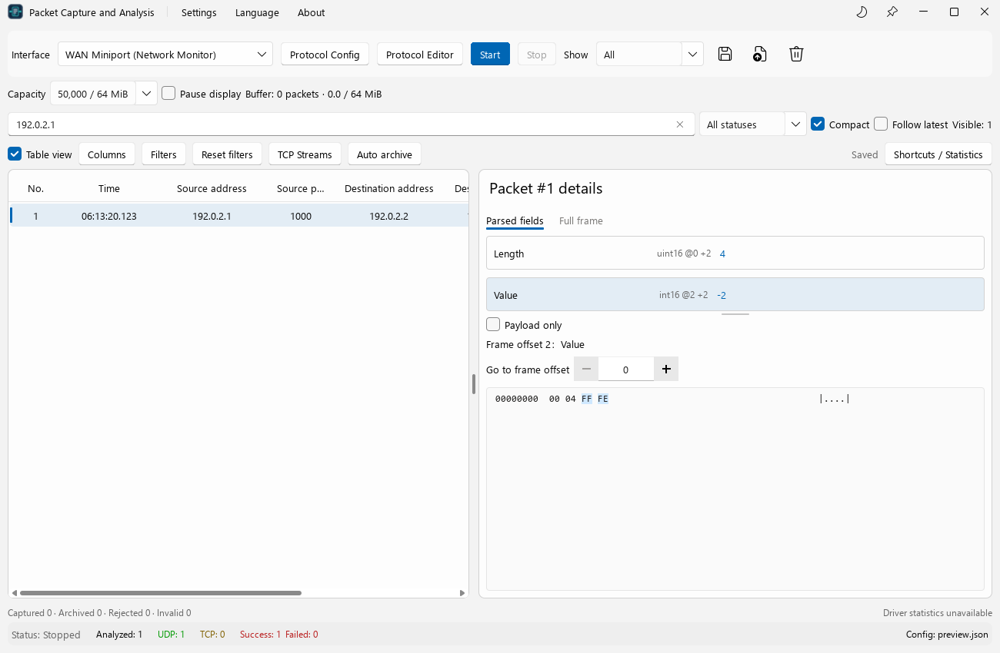
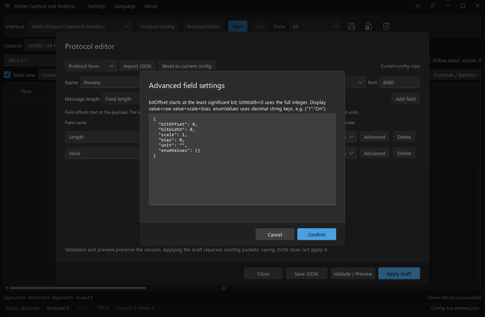
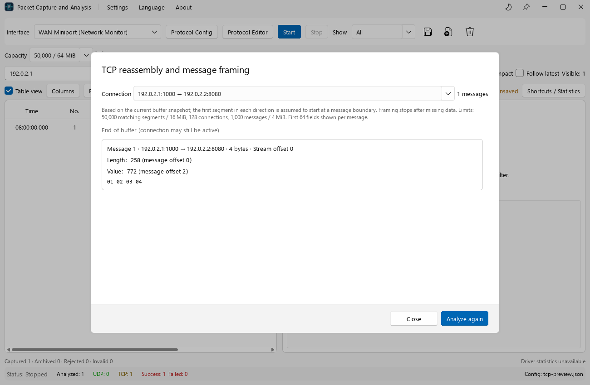

# PacketCaptureTool User Manual

[中文](user_manual.md) | [English](user_manual.en.md) · [Project README](../README.en.md)

Updated: 2026-10-11. Applies to the current source tree, including TCP stream analysis, the protocol editor, extended fields, bilingual UI, system tray, and configuration directory management.

This manual follows the current UI and configuration validation rules. The third optimization stage is still in progress. Example files may be edited during debugging, so check the JSON you actually load.

## Contents

1. [Purpose and capabilities](#purpose-and-capabilities)
2. [Preparation and first launch](#preparation-and-first-launch)
3. [Quick start without network traffic](#quick-start-without-network-traffic)
4. [Main window and basic controls](#main-window-and-basic-controls)
5. [Live capture, sessions, and pause display](#live-capture-sessions-and-pause-display)
6. [Offline files and saving](#offline-files-and-saving)
7. [Search, conditions, and tables](#search-conditions-and-tables)
8. [Packet details, Hex, and byte navigation](#packet-details-hex-and-byte-navigation)
9. [Protocol configuration reference](#protocol-configuration-reference)
10. [Protocol editor](#protocol-editor)
11. [TCP reassembly and message framing](#tcp-reassembly-and-message-framing)
12. [Capacity, auto archive, and rotation](#capacity-auto-archive-and-rotation)
13. [Statistics, preferences, and shortcuts](#statistics-preferences-and-shortcuts)
14. [Typical workflows](#typical-workflows)
15. [Troubleshooting](#troubleshooting)
16. [Current limits and future work](#current-limits-and-future-work)
17. [Appendix: terminology, building, and links](#appendix-terminology-building-and-links)

## Purpose and capabilities

PacketCaptureTool captures interface traffic, opens capture files, and interprets TCP/UDP application payloads using user-defined JSON rules. It supports device communication debugging, binary protocol validation, field-to-byte inspection, and offline reproduction.

| Capability | Current behavior |
| --- | --- |
| Live capture | Select an interface, start/stop, and continue the current session |
| Offline reading | PCAP and PCAPNG; background reading/parsing with packet-count progress and cancellation |
| Manual saving | All raw packets in the current memory window, as PCAP |
| Basic network recognition | IPv4/IPv6 TCP/UDP, ARP, ICMP, and ICMPv6 |
| Custom protocols | One active TCP or UDP configuration; match source or destination port |
| Field types | Signed/unsigned integers, floats, UTF-8 strings, and raw byte arrays |
| Extended fields | Unsigned bit fields, integer enums, scale, bias, and units |
| Message length | Fixed, or an unsigned integer field containing total message length |
| Analysis views | Table/cards, display filters, search, conditions, sorting, custom field columns |
| Bytes | Hex/ASCII with field/byte navigation in both directions |
| TCP streams | Background reassembly of a memory snapshot, bidirectional framing and diagnostics |
| Auto archive | PCAP rotation by size/time/link type; rolling memory retention after safe archiving |
| UI | FluentUI style, light/dark themes, Simplified Chinese/English switching, shortcuts |
| Desktop integration | Window/taskbar/tray icons; tray show, start/stop, and exit actions |
| Settings | `settings.ini` with a directory you can view, open, or change |

Basic recognition is not a complete built-in application decoder. Recognizing TCP/443 does not decrypt TLS. Naming a JSON protocol HTTP or Modbus does not automatically supply parsing rules.

## Preparation and first launch

### Running the app

For an existing single-configuration Release build, an example executable location is:

```text
cmake-build-release/PacketCaptureTool.exe
```

Keep accompanying Qt DLLs, plugins, `qml`, and other deployment files. Copy the complete deployment directory when moving the app; the EXE alone may fail. Output location depends on the generator; see the README for first-time building.

Windows live capture requires the installed Npcap driver and an available interface. If capture fails, check the driver, interface state, and permissions. Administrator privileges are not required for every launch; follow the actual error and driver access policy.

### Suggested first steps

1. Validate a known payload in the editor to confirm offsets, endianness, and values.
2. Select the interface carrying traffic and load the protocol configuration.
3. Capture briefly to check addresses, ports, and payload length.
4. Configure capacity and auto archive before a long capture.

A custom configuration is optional. Capture/import still works without one, but custom fields are not decoded.

### Before updating the executable

Save needed packets and use **Settings → Exit** or tray **Exit**. By default the window close button only hides the app to the tray. Windows locks running EXE/DLL files, which can prevent rebuilding/deployment. Exit fully before replacing them; no capture-file deletion or JSON modification is needed.

## Quick start without network traffic

1. Open **Protocol Editor**.
2. Choose **Import JSON** and load [extended_fields_example.json](extended_fields_example.json).
3. Select **Hex preview**.
4. Enter the application payload:

   ```text
   3F C0 00 00 21
   ```

5. Click **Validate / Preview**.
6. Check the following:

| JSON field | Raw value | Display | Explanation |
| --- | --- | --- | --- |
| `电压` (voltage) | 1.5 | `4 V` | Big-endian float32, `1.5 × 2 + 1 = 4` |
| `状态` (status) | 2 | Ready label with value 2 (`就绪`) | Two bits starting at bit 4 of `0x21` |
| `原始标志` (raw flags) | 33 | `33` | All of `0x21` as uint8 |

The last byte belongs to both status and raw flags, demonstrating overlap. Language switching does not translate JSON names/labels. Previewing does not activate the draft; stop capture and click **Apply draft** to use it.

## Main window and basic controls



Screenshots were regenerated from the current source on 2026-10-11 using the English UI and synthetic automated-test data. Their counters do not establish real-session count relationships.

| Area | Controls/content |
| --- | --- |
| Title bar | Settings, Language, About, theme, window controls |
| Capture toolbar | Interface, Protocol Config, Protocol Editor, Start/Stop, UDP/TCP/All, save/import/clear |
| Capacity row | Capacity, Pause display, retained packets/raw bytes |
| Search row | Search, parsing status, Compact, Follow latest, visible count |
| Analysis controls | Table, columns, conditions, reset, TCP Streams, Auto archive, save status, help |
| Left | Scrollable/selectable table or cards |
| Right | Selected packet's parsed fields and full-frame tabs |
| Bottom | Capture/archive/rejection/recognition counters, driver statistics, analysis totals, configuration |

Drag the middle divider to resize list/details. Scroll horizontally when columns exceed list width. Minimum supported window size: **1000 × 650**.

### Interface selection

Open the interface selector, compare descriptions and separately displayed IP, and select the traffic-carrying interface. Long names wrap in a wider dropdown. Use vertical scrolling or keyboard navigation for many interfaces. The collapsed label may be ellipsized; the expanded list shows the name without needing scrolling text.

VPN, Wi-Fi, wired, virtual, and loopback interfaces may coexist; the first entry is not necessarily correct. The displayed IP is identification assistance, not a complete address list. No displayed IP does not necessarily mean frames cannot be captured.

### Themes and dialogs

Use the title-bar theme control for light/dark mode; the preference is saved. FluentUI styling applies to controls and dialogs. Primary actions use the theme color, and dialog actions appear at the bottom.

### Language and About

Choose **Language → 简体中文 / English** for immediate switching without restarting. The choice persists. Current display-filter, capacity, and editor selections are preserved. User-defined JSON field names, enum labels, and data retain their original text.

On Windows, Chinese prefers Microsoft YaHei and English prefers Segoe UI, depending on installed fonts. Hex remains monospaced. **About** shows build version, author Rookie, copyright, and a clickable GitHub link.

### Tray and exiting

**Settings → Close window to tray** is enabled by default. With tray support, closing hides the window while capture/archiving continue. **Settings → Hide to tray** also hides it manually.

Single/double-click the tray icon to show the window. Right-click for show, start/stop, and exit actions. Starting still requires a valid interface and an allowed capture state. **Settings → Exit** or tray **Exit** terminates the app after handling unsaved packets. Canceling exit keeps data; capture already stopped for the workflow must be restarted manually.

Disable Close window to tray to make the close button exit normally. Without tray support, closing also follows the exit workflow. The app icon is embedded in the Windows EXE and used in the window, taskbar, and tray.

### Configuration directory

1. Open **Settings → Configuration directory…** to inspect the directory containing `settings.ini`.
2. Use **Open directory** to view it in the file manager.
3. Use **Change directory…** and select a writable folder. Current settings migrate immediately, and the location persists.

Default: Qt's user application configuration directory, typically `%LOCALAPPDATA%/PacketCaptureTool/Packet Capture Tool` on Windows; trust the actual dialog path. Old files remain. A different existing `settings.ini` at the destination is rejected; select another folder.

Protocol JSON dialogs default to this directory, but existing JSON files do not move. Capture files and the archive directory also stay in their original locations. Settings do not contain raw packets or drafts; preserve PCAP and JSON separately for reproduction.

## Live capture, sessions, and pause display

### A complete capture

1. Select the interface.
2. Load JSON using **Protocol Config**, or leave it unloaded for raw traffic.
3. Select capacity.
4. Click **Start**, then generate device/client traffic.
5. Check addresses, ports, protocol, and parsing status.
6. Click **Stop**.
7. Save with the save button or `Ctrl+S`.

Configuration `port` matches source or destination; it does not bind a listening service. The top display selector filters the list, not driver capture.

| Action | Data effect |
| --- | --- |
| Start | Keep existing packets and append new ones |
| Stop | Retain data; wait for archive writes |
| Start again | Continue the session without clearing |
| Clear | Clear analysis and in-memory packets available for saving |
| Successful import | Replace the session with file data; stop live capture |

Separate experiments by stopping, saving, clearing, then starting. Clear does not delete existing archive files.

### Pause display, follow latest, and compact

**Pause display** stops new additions to the analysis list. Capture, memory retention, and archiving continue. Resuming fills from the current window. Archived packets evicted while paused must be reopened from files.

Pausing cannot replace stopping or bypass capacity. **Follow latest** follows the list end; disable it for history. With sorting, the last row may not be newest, so reset sorting as needed. **Compact** reduces row/card height. These controls combine independently.

## Offline files and saving

### Importing PCAP/PCAPNG

1. Click import or press `Ctrl+O`.
2. Handle the unsaved-packet prompt.
3. Select `.pcap` or `.pcapng`.
4. Wait for background reading/parsing; progress reports packets read, not an exact percentage.
5. Use cancel import or `Esc` to cancel.

Success replaces the session. Cancellation, failure, or capacity overflow preserves old data. The UI stops capture before import; cancellation does not automatically restart it.

No configuration is needed to import. Loading one later reparses the current list and updates status; reopening the capture is unnecessary when changing field definitions.

### Saving scope and formats

Save and `Ctrl+S` write **all raw packets in the current window**, including hidden rows. They do not save only visible rows or embed parsed fields/editor drafts.

Saving stops capture first and uses atomic commit. Failure preserves an existing destination and unsaved state. Resume capture afterward if needed, and save newly received packets again. With archiving, manually saved data covers only the retained window; complete capture resides in archive files.

Read PCAP/PCAPNG; write PCAP. Renaming to `.pcapng` does not change output format. Original link type is retained; mixed-link sessions cannot be saved into one single-link PCAP. Internal timestamps retain microseconds; tables usually display milliseconds. Complete PCAPNG interface metadata and higher precision are not fully preserved on export.

### Unsaved-packet prompts

| Choice | Result |
| --- | --- |
| Save then continue | Perform the pending action only after successful saving |
| Discard and continue | Continue; unsaved memory packets may be cleared, replaced, or lost on exit |
| Cancel | Keep data, cancel the action; stopped capture does not resume automatically |

Clear, import, and exit use this prompt. Canceling the subsequent save-file dialog also cancels the pending action. These choices do not delete archive files.

## Search, conditions, and tables

### Combining filters

Transport, status, search, and structured conditions apply together. OR changes only the condition group's internal combination; external filters remain effective. Reset conditions clears search, restores all transports/statuses, removes conditions, and restores default ordering. It does not remove packets, reset column widths, or change JSON.

### Search

Search is case-insensitive and includes IPs, ports, protocol names, field names/display values, errors, and Hex in the complete frame.

| Example | Use |
| --- | --- |
| `192.168.1.20` | Address text |
| `8080` | Port or other text |
| `电压` | Example JSON field name |
| `就绪` | Example enum label |
| `3F C0 00 00` / `3FC00000` | Complete-byte Hex sequence |

Search is not a Wireshark expression parser; `tcp.port == 8080` does not create a condition. Hex needs an even number of digits, optionally separated by ordinary spaces, without `0x`, commas, offsets, or ASCII. Odd-length Hex may match as ordinary text but is not a valid byte query.

### Structured conditions

Open the conditions dialog, select AND (all) or OR (any), add conditions, enter a property or `field:FieldName`, operator, and value, then apply. Invalid conditions preserve an earlier valid filter.

| Property | Meaning | Example |
| --- | --- | --- |
| `sequence` | Stable session packet number | `12` |
| `timestamp` | Numeric microsecond timestamp, not formatted table time | Numeric timestamp |
| `sourceIP` / `destIP` | Addresses | `192.168.1.20` |
| `sourcePort` / `destPort` | Ports | `8080` |
| `protocol` | Network protocol used in the table | `TCP`, `UDP` |
| `length` | Raw packet bytes | `64` |
| `status` | Parsing state | `0` unparsed, `1` unmatched, `2` success, `3` failure |
| `error` | Error/unmatched explanation | Text |
| `field:电压` | Raw value of the exact field named `电压` | `1.5` |

Operators: equals/not-equals/contains/greater/greater-or-equal/less/less-or-equal/exists. Maximum **32 conditions**. Numeric comparisons require numbers on both sides. Exists needs no value. Missing fields do not satisfy not-equals; use exists to check extraction. Property/field names must be exact.

For successful packets to port 8080 with raw voltage above 1, use AND: `destPort equals 8080`, `status equals 2`, `field:电压 greater than 1`.

Scale/bias only change display: example `4 V` has raw value `1.5`. Bit fields compare extracted numbers; enums compare numeric keys. Search matches labels. A Contains shortcut using converted display text may not match raw values; edit the condition or use search.

Right-click a detail field to append equals/not-equals/contains/exists using AND. Existing external filters remain. Check conflicting conditions when results become empty.

### Table and cards

Enable Table view for a table or disable it for cards. Headers/cells are centered, without the old cell hover tooltip. Widen columns, scroll, or view details for truncated text.

Configure columns to show/hide (retain at least one), set width **48–600**, move up/down, and add exact custom field names. Maximum **40 columns**, without duplicate custom fields. Custom columns show formatted values but sort by raw values. Missing fields display `—`.

Click headers for ascending then descending sorting. Packet numbers remain stable, not row indices. Details try to retain the same packet; reselect if filtered out or evicted.

## Packet details, Hex, and byte navigation

| State | Meaning | Next step |
| --- | --- | --- |
| Unparsed | No usable configuration, etc. | Load JSON |
| Unmatched | Wrong transport/port or other protocols such as ARP/ICMP | Check matching or inspect raw bytes |
| Success | Matching, length, bounds, and extraction passed | Inspect fields |
| Failure | Matched, but length/completeness/extraction failed | Read error and check rules |

Unmatched does not count as parsing failure. TCP under a UDP configuration does not indicate a UDP parser bug.

Click fields to highlight bytes; click Hex bytes for covering fields (possibly several when overlapping). Enter a frame offset to locate a byte. Focused fields also support Enter. Full-frame view supports selection and Hex copying. ASCII displays non-printable bytes as dots and is not UTF-8 field parsing.

### Layout and copying

Drag the field/Hex divider to adjust height; each area scrolls independently. With no custom fields, Hex uses the remaining area.

Select data in either packet Hex view and press `Ctrl+C` or **Copy packet hex data**. It copies complete packet bytes intersecting the selection as uppercase, space-separated Hex, excluding offsets/ASCII even across lines. Selecting only offsets/ASCII copies no bytes. **Copy all hex bytes** copies the current view's bytes; payload-only view copies only that payload.

Paste payload bytes into the editor; remove network headers from full-frame copies first. Other text inputs retain their own normal copying behavior.

### Offset bases

| Location | Zero point |
| --- | --- |
| JSON `offset` / editor preview | Application payload or individual message |
| Packet detail / frame locator | Complete captured frame |
| TCP message fields | Individual reassembled message |
| TCP stream offset | Beginning of that direction's reconstructed stream |

Payload-only display crops bytes but keeps frame-relative addresses. JSON offset 0 may appear at frame offset 42; do not change JSON to force frame zero. TCP options, VLAN, IPv6, etc. can change header length.

## Protocol configuration reference

### Basic example and top-level properties

Save as `DemoUDP.json` or paste into JSON source:

```json
{
  "protocolName": "DemoUDP",
  "transportType": "UDP",
  "port": 8080,
  "length": { "type": "fixed", "fixedValue": 6 },
  "fields": [
    { "name": "MessageType", "offset": 0, "length": 2, "type": "uint16", "endianness": "big" },
    { "name": "Value", "offset": 2, "length": 4, "type": "int32", "endianness": "big" }
  ]
}
```

Preview `00 01 FF FF FF FE`: MessageType 1, Value -2.

| Required property | Rule |
| --- | --- |
| `protocolName` | Nonempty name; not a built-in decoder selector |
| `transportType` | TCP or UDP, not Both/All/ICMP |
| `port` | Integer 1–65535; source or destination |
| `length` | Fixed or field-based |
| `fields` | Array, maximum 1024 fields; empty allowed |

JSON is limited to **1 MiB**. Use double quotes, no comments/trailing commas, and JSON numbers for numeric properties, not quoted numbers or Hex literals.

### Fixed length

```json
{ "type": "fixed", "fixedValue": 6 }
```

Total payload/message length is **1–65536 bytes**, excluding network headers. Actual length must equal it. Reserved bytes count even without fields. UDP excludes Ethernet padding using declared payload length. Raw TCP list checks segment payload; stream analysis handles split/coalesced messages.

### Length field

```json
{
  "protocolName": "LengthPrefixedTCP",
  "transportType": "TCP",
  "port": 8080,
  "length": { "type": "variable", "fieldName": "TotalLength" },
  "fields": [
    { "name": "TotalLength", "offset": 0, "length": 2, "type": "uint16", "endianness": "big" },
    { "name": "Value", "offset": 2, "length": 2, "type": "uint16", "endianness": "big" }
  ]
}
```

`00 04 00 2A` yields total length 4/value 42. `00 02 00 2A` fails: declared 2 differs from actual 4.

Referenced field must exist, be unsigned integer, and not be a bit field. Its definition sets offset/endianness; legacy `length.fieldOffset` is not a separate read location. Raw length means **the whole message including its length field**. `bias` cannot adjust a body-only length for framing; conversion affects display only.

Variable length does not give dynamic fields. Offsets/widths remain fixed; dependent strings, arrays, and nested structures are not implemented.

### Fields and types

| Property | Rule |
| --- | --- |
| `name` | Nonempty, unique |
| `offset` | Integer 0–65536 relative to application payload |
| `length` | Integer 1–65536; numeric types require exact width |
| `type` | Listed below |
| `endianness` | big or little |

`offset + length` must fit the fixed message/actual payload. Overlap is allowed; duplicate names are not.

| Type | Bytes | Meaning |
| --- | ---: | --- |
| `uint8` / `int8` | 1 | Unsigned 0–255 / signed -128–127 |
| `uint16` / `int16` | 2 | Unsigned / signed 16-bit |
| `uint32` / `int32` | 4 | Unsigned / signed 32-bit |
| `uint64` / `int64` | 8 | Unsigned / signed 64-bit |
| `float32` | 4 | IEEE 754 single precision |
| `float64` | 8 | IEEE 754 double precision |
| `string` | Fixed user width | UTF-8, whitespace retained, trailing NUL removed |
| `bytearray` | Fixed user width | Uppercase Hex bytes |

`00 2A` is uint16 42 big-endian or 10752 little-endian. One-byte/string/bytearray fields are not numerically reversed, but retain `endianness` in JSON. NaN, Infinity, and non-finite converted values fail parsing. Float displays use limited significant digits, not lossless serialization.

### Bit fields

Only unsigned integers support them:

```json
{
  "name": "Status", "offset": 4, "length": 1,
  "type": "uint8", "endianness": "big",
  "bitOffset": 4, "bitWidth": 2
}
```

Read the complete integer in its byte order, then count from the **least significant bit**:

```text
value = (unsigned integer >> bitOffset) & ((1 << bitWidth) - 1)
```

`bitOffset`: 0–63; `bitWidth`: 0–64; sum cannot exceed type width. Width 0 means full integer and requires offset 0. `0x21` shifted by 4 and masked to two bits yields 2. Highlighting covers underlying bytes, not individual bits. Multiple bit fields may share bytes.

### Enums

```json
"enumValues": { "0": "Off", "1": "On", "2": "Ready" }
```

Integer-only, with canonical decimal string keys in field/bit-field range and nonempty labels. Signed fields allow negative keys. Avoid `"0x02"`, `"02"`, `"+2"`, and fractional keys. Matched values show labels with raw numbers; unmapped values stay numeric without failing. Keep 64-bit keys as strings to avoid JavaScript precision loss.

### Scale, bias, unit

```json
"scale": 0.1,
"bias": -10,
"unit": "℃"
```

Numeric display is `raw × scale + bias` plus unit; defaults 1, 0, empty. Strings/bytearrays do not support conversion/units. Raw 250 displays `15 ℃` but conditions use 250. Enums plus conversion show label, raw, and converted values. Conversion uses double precision and may lose large-integer precision; unconverted 64-bit raw integers display exactly.

## Protocol editor

Protocol Config activates a file directly. Protocol Editor edits a draft. It opens the active configuration's copy, or a template. Draft edits survive closing/reopening the editor in the same run, but not app exit unless saved. Reset to current configuration discards edits; importing another JSON replaces the draft.

| View | Purpose |
| --- | --- |
| Protocol form | Name/transport/port/length, add/delete fields, edit types/width/endian |
| JSON source | Full rules, bulk edits, precise advanced attributes |
| Hex preview | One complete message with raw/display results |

Changing type requires checking width and offsets (float32 needs four bytes). No field-moving or automatic offset rearrangement. Leaving JSON view validates rules; fix errors before switching. Formatting/property order can change without semantic changes.

### Advanced attributes

The field's advanced action edits `bitOffset`, `bitWidth`, `scale`, `bias`, `unit`, `enumValues` as a JSON object. Confirmation validates the complete configuration. Edit name/offset/type/width in the main form or full JSON.



| Action | Active configuration | Writes JSON |
| --- | --- | --- |
| Import into editor | Unchanged | No |
| Validate / Preview | Unchanged | No |
| Apply draft | Replaces and reparses | No |
| Save JSON | Unchanged | Yes |
| Protocol Config load | Replaces | No |

Apply requires capture stopped and no import. Invalid drafts do not replace active rules. An editor-draft label without a file association is expected, not failure. Save requires valid configuration and uses atomic commit; invalid sample Hex does not prevent saving valid rules. The unsaved-packet exit prompt does not save drafts.

### Hex rules

Enter one complete application message without headers. Continuous digits, ordinary spaces/newlines, either case are accepted. Digits after whitespace removal must be even. Payload limit: **64 KiB**; input including whitespace: **256 Ki characters**. No `0x`, commas, hyphens, offsets, or ASCII. Empty input validates rules only. Preview is local, sends no packets, and checks no real interface/address.

## TCP reassembly and message framing

TCP is a byte stream: one message may span segments and one segment may carry several messages. Raw-list length errors may reflect segmentation/coalescing.

1. Load TCP rules with correct port/message length.
2. Capture/import a complete conversation, preferably before its start.
3. Open **TCP Streams** for background analysis of the current window snapshot.
4. Select a bidirectional connection.
5. Inspect direction, length, stream offset, fields, and Hex.
6. Reanalyze after new traffic, or explicitly cancel analysis.



The screenshot uses TCP/8080 four-byte synthetic messages. This independent example differs from the editable repository sample:

```json
{
  "protocolName": "TCP4ByteDemo",
  "transportType": "TCP",
  "port": 8080,
  "length": { "type": "fixed", "fixedValue": 4 },
  "fields": [
    { "name": "MessageType", "offset": 0, "length": 2, "type": "uint16", "endianness": "big" },
    { "name": "Value", "offset": 2, "length": 2, "type": "uint16", "endianness": "big" }
  ]
}
```

`00 01 00 2A 00 02 00 64` yields type 1/value 42 and type 2/value 100 after correct reassembly, regardless of segmentation/coalescing.

Supports IPv4/IPv6, both directions, segmentation/coalescing, repeated retransmissions, out-of-order traffic, fixed framing, and length fields spanning segments. Length-field framing uses total message length and defined endianness.

It does not change the raw table or per-packet success/failure counts. Message counts differ from packet counts. Retained data can be analyzed while display is paused.

| Diagnostic | Meaning/action |
| --- | --- |
| Window ended | Snapshot ended; capture more and reanalyze |
| FIN/RST | Connection-ending traffic observed |
| Missing packets | Stop framing that direction instead of joining across a gap |
| Incomplete trailing message | Insufficient bytes from snapshot end or loss |
| Invalid length | Rules violated; no guessed new boundary |
| Limited/incomplete | Reduce input to meet limits |

Limits: **50,000 matching segments / 16 MiB**, **128 connections**, **1,000 messages / 4 MiB**; display first **64 fields / 512 Hex bytes** per message.

The first segment of each direction is assumed to start at a message boundary. Mid-conversation capture/rolled windows can misalign, especially with fixed lengths. Divisibility does not prove alignment. No synchronization recovery, complete reused-four-tuple session distinction, incremental stream view, stream export, or IP fragment reassembly.

Results use the click-time snapshot; new packets do not append automatically. Clear/configuration changes cancel analysis and invalidate results. Closing the dialog alone does not explicitly cancel the task.

## Capacity, auto archive, and rotation

| Preset | Packets | Raw bytes |
| --- | ---: | ---: |
| Small | 10,000 | 16 MiB |
| Default | 50,000 | 64 MiB |
| Large | 100,000 | 128 MiB |

Either limit controls admission. Change while stopped/not importing; reduction below usage may be rejected. Without archiving, capacity stops capture and keeps data; save/clear or raise capacity. Oversized imports are rejected completely. Raw-byte limits exclude parsing/UI/stream memory; imports temporarily retain old and new sessions.

### Enabling archive

1. Stop and save needed data.
2. Clear; enabling requires an empty session.
3. Open **Auto archive**, choose a writable directory with space.
4. Set file size, seconds, and maximum files.
5. Enable/update and start capture.

| Parameter | Range | Default |
| --- | --- | --- |
| MiB/file | 1–1024 | 64 |
| Seconds | 1–86400 | 300 |
| Maximum files | 1–10000 | 1000 |

Size/time or a link-type change rotates files. Time is checked on the next packet, not by creating idle empty files. A packet larger than target size occupies its own file.

A separate thread writes. Eviction removes only safely written/flushed or manually saved older packets. Unique task IDs prevent overwrites; files are not automatically deleted. Maximum files applies **per task**, not to all history; this is not a disk ring buffer.

Stop waits for queued writes. Parameters persist, but archive enablement does not survive restart. Confirm enabled before long captures. To disable, stop and choose disable in settings; closing the dialog only dismisses it.

File limit, full queue, write failure, or inability to free safe window space stops capture. Files remain; save any unarchived window data. Default queue: **8192 packets / 16 MiB**, plus work batch up to **128 packets**. Pausing display cannot fix input exceeding disk throughput; inspect space/permissions/speed/task limit and driver drops.

## Statistics, preferences, and shortcuts

| Counter | Meaning |
| --- | --- |
| Capture | Valid packets accepted in this session |
| Window | Retained raw packets/bytes |
| Analysis | Packets added to the model, not complete TCP messages |
| Visible | Rows after filters |
| UDP/TCP | Analysis-model protocol counts, not all traffic |
| Success/failure | Current per-packet parsing; updates on reparsing |
| Unrecognized | Records that cannot become valid recognized packets; not all non-TCP/UDP |
| Rejected | Application admission failures |
| Archived/written | Successfully archived packets |
| Pending | Archive work awaiting processing |
| Driver received/dropped/interface dropped | Driver/Npcap metrics, separate from application rejection |

Pause, filtering, and eviction cause differing totals. Driver statistics may be unavailable before capture, on unsupported interfaces, or after retrieval failure; unavailable does not guarantee zero drops.

Saved preferences: language, settings location, close-to-tray, window geometry, list/detail width, interface stable ID, theme, capacity, table/cards, columns, compact/follow, payload-only, archive directory/parameters. Unsaved packets, editor drafts, and TCP results are not restored. Previous JSON does not automatically reload by guarantee. Search/conditions/sorting/pause are not persisted.

| Shortcut | Action |
| --- | --- |
| Ctrl+O | Import, handling unsaved packets |
| Ctrl+S | Stop and save the entire window |
| Ctrl+F | Focus search |
| F6 | Focus packet list |
| Ctrl+C in packet Hex views | Copy packet bytes without offsets/ASCII |
| Arrow keys | Navigate focused lists/selectors |
| Esc | Cancel import, otherwise clear search; dialogs may handle Escape first |

In-app shortcut/statistics help gives a brief reference.

## Typical workflows

### UDP sensor debugging

Validate known Hex, edit/save the actual port, select interface, apply, capture. Filter to UDP/success and add voltage/status columns. Convert physical thresholds back to raw values for numeric conditions. Save PCAP and JSON separately.

### TCP length mismatch

Check port/total length and whether the segment contains partial/multiple messages. Inspect TCP Streams and gap/boundary diagnostics. Recapture before communication starts if needed; keep PCAP/configuration.

### Long intermittent-failure capture

Validate traffic briefly, stop/save/clear, enable archive, and set rotation/task limits for duration/traffic. Watch drops, rejections, pending writes, files. Stop after the event and wait for writes; save retained packets. Locate files by time. Messages spanning rotated files may be incomplete when reading one; no multi-file merge-analysis entry point exists.

### Sharing a reproduction

Keep PCAP and JSON, interface type, addresses/ports, action sequence, expected/actual values, and errors. PCAP does not include custom rules, so the file alone may not reproduce parsing.

## Troubleshooting

| Symptom | Check/action |
| --- | --- |
| Missing DLL/QML | Use complete deployment or rebuild/deploy |
| Closing leaves process / EXE locked | Exit through Settings/tray before rebuilding |
| Cannot change settings directory | Check permissions/conflicting settings.ini; use another writable folder |
| Chinese fields in English UI | Names/labels come from JSON; edit JSON if needed |
| Empty interfaces | Check Npcap/enabled interfaces; restart after changes |
| Interface not found | Reselect after removal/change |
| Cannot open interface | Follow actual driver/permission error; appropriate privileges if needed |
| No traffic visible | Check interface/traffic/pause/filters |
| Window nonempty, no visible rows | Reset conditions; check pause |
| Unparsed | Load JSON or valid draft |
| Unmatched/port mismatch | Check transport and either port |
| Fixed length mismatch | Exclude headers; use streams for TCP segmentation/coalescing |
| Declared length mismatch | Check total-message semantics and endian |
| Field out of range | Check byte offsets/width/completeness, not Hex character count |
| Unexpected integer | Check endian/signedness/offset; big-endian 00 2A is 42 |
| Float error | Correct 4/8-byte width/endian; check NaN/Infinity |
| Invalid bit field | Unsigned integer, LSB offset, valid bounds |
| Invalid enum | Canonical decimal keys in range, nonempty labels |
| Hex rejected | Remove prefixes/offsets/ASCII; complete bytes and size limits |
| Cannot leave JSON view | Fix required properties/widths/references |
| Apply unavailable | Stop; finish/cancel import |
| Window full | Save/clear or increase; archive longer tasks |
| Import too large | Increase capacity or split externally |
| Cannot enable archive | Save/clear and check writable directory |
| Archive queue/write failure | Save unarchived data; check disk/space/limits |
| Max files | Adjust next task; old files are not overwritten |
| Mixed-link PCAP save fails | Keep source PCAPNG; no combined mixed-link export |
| TCP no messages | Check TCP/port/gaps/alignment; recapture from start |
| Conditions miss display values | Use raw numbers, search for labels |
| Counts change after JSON load | Existing data was reparsed |

Troubleshoot in order: confirm raw data, pause/filters, protocol/port, payload start/length, known-Hex field validation, TCP diagnostics, then capacity/archive/driver counters.

## Current limits and future work

| Area | Current boundary |
| --- | --- |
| Multi-protocol | One active configuration; no automatic switching |
| CRC/checksum | No configurable CRC/additive validation; parsing success does not prove business checksum |
| Dynamic/nested fields | Fixed offsets/widths |
| Request/response | Bidirectional display, no automatic pairing/business latency |
| Comparison/trends | No complete comparison or trend view |
| TCP enhancement | No resynchronization/incremental analysis/complete reuse detection/export |
| IP fragments | No complete reassembly |
| PCAPNG export | PCAP output; incomplete metadata preservation |
| Editor | Field moving, library, cross-run drafts remain future work |
| Encryption/decoders | No automatic TLS decryption or decoder selected by name |

Automated coverage includes configuration, samples, file I/O, capacity, archiving, streams, and QML. Sustained physical-interface throughput, disk-full experiments, and manual screen-reader acceptance are not complete; use current counters/archive status to assess heavy-load completeness.

## Appendix: terminology, building, and links

| Term | Meaning |
| --- | --- |
| Raw frame/packet | One captured record and bytes |
| Application payload | Business data after TCP/UDP headers |
| TCP segment | Network unit, not necessarily one message |
| Application message | Record framed by configuration |
| Memory window | Retained data available for viewing/manual save |
| Display filter | Visibility change without deleting data |
| Archive | Automatic rotating capture files |
| Endianness | Multi-byte numeric byte order |
| MiB | 1,048,576 bytes |
| Hex | Two hexadecimal characters per byte, e.g. 2A |

### Build and tests

With an existing configured build, from project root:

```powershell
cmake --build cmake-build-release --parallel 4
ctest --test-dir cmake-build-release --output-on-failure
```

CMake, configured compiler, and Qt paths must be available. See README for initial configuration; generator/kit determines EXE location. Suites: TcpStreamTests, PacketCaptureTests, ConfigurationLoaderTests, ProtocolValidationTests, QmlInterfaceTests. UI screenshots use synthetic data, not your live session.

### Links

| File | Content |
| --- | --- |
| [English README](../README.en.md) / [中文 README](../README.md) | Overview, dependencies, build, quick use |
| [中文使用手册](user_manual.md) | Chinese manual |
| [Extended example](extended_fields_example.json) | Voltage/bit field/enum/overlap; Hex 3F C0 00 00 21 |
| [TCP example](tcp_stream_example.json) | Editable rules; check port/length |
| [Test configuration](test.json) | Existing debug rules |
| [TCP header guide](tcp_header_hex_guide.md) | Header bytes (Chinese) |
| [UDP header guide](udp_header_hex_guide.md) | Header bytes (Chinese) |

At this update, test.json uses UDP/53744 and 347-byte payloads; tcp_stream_example.json uses TCP/443 and 43 bytes despite the TCP4ByteMessage name. Check actual files before use. The four-byte example above is independent and does not require modifying these files.

Manual screenshots are docs/screenshots/manual-*.png from automated UI previews. Use actual session values for configuration/counters.
