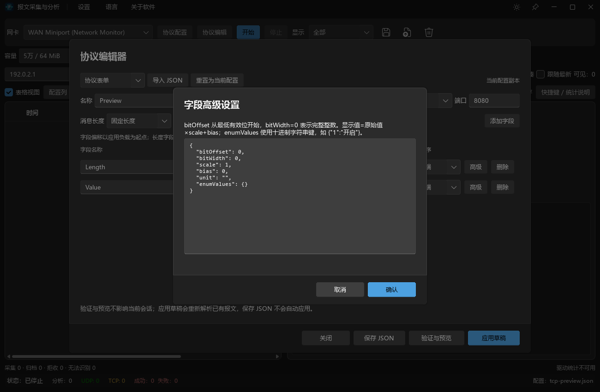
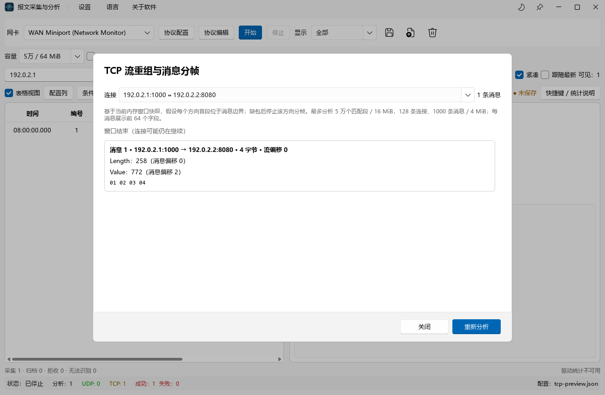

# PacketCaptureTool 中文使用手册

[中文](user_manual.md) | [English](user_manual.en.md) · [项目 README](../README.md)

文档更新日期：2026-10-11。适用于当前源码版本，涵盖 TCP 流分析、协议编辑器、字段扩展、中英文界面、系统托盘及配置目录管理。

本手册以当前代码、界面文字和配置校验规则为依据。第三阶段仍在推进中；文中明确区分已支持的操作与尚未实现的能力。示例配置可能被用户修改，实际参数请以打开的 JSON 内容为准。

## 目录

1. [软件用途与能力范围](#软件用途与能力范围)
2. [运行准备与首次启动](#运行准备与首次启动)
3. [快速上手：不抓包也能验证协议](#快速上手不抓包也能验证协议)
4. [主界面与基本操作](#主界面与基本操作)
5. [实时采集、会话与暂停显示](#实时采集会话与暂停显示)
6. [离线文件与保存](#离线文件与保存)
7. [搜索、条件筛选与表格](#搜索条件筛选与表格)
8. [报文详情、Hex 与字节定位](#报文详情hex-与字节定位)
9. [协议配置完整参考](#协议配置完整参考)
10. [协议编辑器操作](#协议编辑器操作)
11. [TCP 流重组与消息分帧](#tcp-流重组与消息分帧)
12. [容量、自动落盘与轮转](#容量自动落盘与轮转)
13. [统计、偏好与快捷键](#统计偏好与快捷键)
14. [典型使用场景](#典型使用场景)
15. [常见故障与排查](#常见故障与排查)
16. [功能边界与后续阶段](#功能边界与后续阶段)
17. [附录：术语、构建与文档索引](#附录术语构建与文档索引)

## 软件用途与能力范围

PacketCaptureTool 用于查看网卡报文、打开抓包文件，以及按照用户定义的 JSON 规则解释 TCP/UDP 应用负载。适合设备通信调试、自定义二进制协议验证、字段定位和离线问题复现。

### 当前支持的能力

| 能力 | 当前行为 |
| --- | --- |
| 实时采集 | 选择网卡后开始、停止采集；停止后可以继续当前会话 |
| 离线读取 | 支持 PCAP、PCAPNG；后台读取、解析，显示包数，可取消 |
| 手动保存 | 保存当前内存窗口全部原始报文为 PCAP |
| 基础网络识别 | IPv4/IPv6 TCP/UDP，ARP、ICMP、ICMPv6 基础识别 |
| 自定义协议 | 当前会话使用一份 TCP 或 UDP 配置；按源/目标端口匹配 |
| 字段类型 | 无符号/有符号整数、浮点数、UTF-8 字符串、原始字节数组 |
| 字段扩展 | 无符号整数位域、整数枚举、比例、偏置、单位显示 |
| 消息长度 | 固定长度，或引用无符号整数字段表示完整消息长度 |
| 分析视图 | 表格、卡片、显示筛选、搜索、结构化条件、排序、自定义字段列 |
| 字节查看 | Hex/ASCII，字段与原始字节双向定位 |
| TCP 流分析 | 对内存快照后台重组、双向分帧、查看完整消息及诊断 |
| 自动落盘 | 按大小/时间/链路类型轮转 PCAP，内存保留最近的安全归档报文 |
| 界面 | FluentUI 风格、浅色/深色主题、简体中文/English 即时切换与常用快捷键 |
| 桌面集成 | 标题栏、任务栏与托盘图标，托盘显示窗口、开始/停止采集及退出 |
| 设置存储 | `settings.ini` 保存软件参数，可在设置菜单查看、更换或打开配置目录 |

“基础识别”表示能够识别网络协议并展示原始数据，不表示已经内置该协议的全部字段解析器。例如，识别 TCP/443 并不等于解密 TLS；填写 HTTP、Modbus 等协议名称，也不会自动加载相应解析规则。

## 运行准备与首次启动

### 运行程序

当前工程已有 Release 版本时，可运行：

```text
cmake-build-release/PacketCaptureTool.exe
```

保留同目录的 Qt DLL、插件目录、`qml` 目录及其他部署文件。迁移程序时应复制完整部署目录，仅复制 EXE 可能导致缺少 DLL 或 QML 模块。

Windows 实时采集依赖 Npcap 及可用的网络接口。若程序能打开但网卡无法采集，先检查驱动安装状态、接口状态和访问权限。具体驱动安装选项可参照工程 README 中的依赖说明；本手册不将“以管理员运行”作为每次启动的必需步骤。

### 首次启动建议

1. 先用协议编辑器验证一条已知 Hex，确认偏移、字节序和显示值。
2. 再选择实际有通信的网卡，加载协议配置。
3. 使用短时间采集验证地址、端口和负载长度。
4. 需要长时间采集时，再配置容量与自动落盘。

启动时不要求先加载自定义协议。未加载配置仍可采集或导入原始报文，只是没有对应的自定义字段解析。

### 更新程序前的处理

编译覆盖 EXE 或 DLL 前，应保存需要保留的报文，并通过 **设置 → 退出软件** 或托盘菜单退出程序。默认点击窗口关闭按钮只是收起到托盘，程序仍在运行。Windows 会锁定正在运行的程序文件，导致链接或部署失败。退出后可以继续构建，无需因此删除抓包文件或修改协议 JSON。

## 快速上手：不抓包也能验证协议

这个例子不需要网卡流量，可直接确认第三阶段的字段扩展是否符合预期。

1. 点击顶部 **协议编辑**。
2. 点击 **导入 JSON**，打开 [extended_fields_example.json](extended_fields_example.json)。
3. 在“编辑器视图”中选择 **Hex 预览**。
4. 输入以下应用负载：

   ```text
   3F C0 00 00 21
   ```

5. 点击 **验证与预览**。
6. 确认结果如下：

| 字段 | 原始解析结果 | 显示值 | 原因 |
| --- | --- | --- | --- |
| 电压 | 1.5 | `4 V` | 大端 float32：`1.5 × 2 + 1 = 4` |
| 状态 | 2 | `就绪（2）` | `0x21` 的第 4 位起取 2 位，结果为 2 |
| 原始标志 | 33 | `33` | `0x21` 作为完整 uint8 解释 |

最后一个字节同时用于状态和原始标志，演示重叠字段。预览结果不会自动成为采集配置；需要用于当前会话时，停止采集后点击 **应用草稿**。

## 主界面与基本操作


截图于 2026-10-11 使用当前源码重新生成，采用中文界面及自动化测试的合成报文，仅用于说明布局。示意图中的窗口、采集和分析计数不用于说明真实会话的计数关系。

### 界面区域

| 区域 | 操作或内容 |
| --- | --- |
| 标题栏 | 设置、语言、关于软件、主题切换及窗口控制 |
| 第一行工具栏 | 网卡、协议配置、协议编辑、开始、停止、UDP/TCP/全部显示、保存、导入、清空 |
| 容量行 | 容量档位、暂停显示、窗口包数和原始数据占用 |
| 搜索行 | 搜索框、解析状态、紧凑、跟随最新、可见包数 |
| 分析工具行 | 表格视图、配置列、条件筛选、重置条件、TCP 流分析、自动落盘设置、保存状态、帮助 |
| 左侧 | 报文表格或卡片列表，可滚动与键盘选择 |
| 右侧 | 当前报文详情，“解析字段”和“完整帧”页签 |
| 底部 | 采集/归档/拒收/识别统计、驱动统计、分析数量及当前配置 |

中间分隔条可以拖动，调整列表与详情宽度。表格总列宽超过列表区域时，可使用底部水平滚动条。界面支持的最小窗口为 **1000 × 650**。

### 选择网卡

1. 展开左上角网卡下拉列表。
2. 对照接口描述和单独显示的 IP 地址，选择承载目标通信的接口。
3. 名称很长时，下拉面板会适当加宽并自动换行。
4. 接口很多时，使用滚轮或纵向滚动条查找；也可用键盘方向键选择并确认。

收起状态下的单行名称可能以省略号结尾；展开列表可查看完整名称。实现采用“展开加宽 + 换行 + 纵向滚动”，不需要等待名称来回滚动。

虚拟网卡、VPN、Wi-Fi、有线网卡和环回接口可能同时出现。应按目标报文实际经过的接口选择，不能只按列表第一项判断。界面显示的 IP 是识别辅助，不代表完整的多地址清单；“无 IP 地址”也不直接等于该接口不能捕获任何帧。

### 主题与弹窗

使用标题栏中的主题切换入口选择浅色或深色。主题偏好会保存。工具栏、菜单、输入框、选择框和弹窗采用 FluentUI 风格；主要确认操作以主题色强调，弹窗操作集中放在底部。

### 中英文切换与关于软件

点击标题栏 **语言**，选择 **简体中文** 或 **English**，界面立即更新，无需重启，选择会在下次启动恢复。切换语言不会改变当前显示筛选、容量及编辑器选择，也不会翻译协议 JSON 中自定义的字段名称、枚举标签或用户数据。

Windows 中文界面优先使用微软雅黑，英文优先使用 Segoe UI；实际字体取决于本机安装情况，Hex 视图继续使用等宽字体。**关于软件** 显示当前构建版本、作者 Rookie、版权信息和可点击的项目 GitHub 链接。

### 系统托盘与真正退出

默认启用 **设置 → 关闭窗口时收起到托盘**。系统支持托盘时，点击关闭按钮只隐藏窗口，实时采集和自动落盘继续运行；选择 **设置 → 收起到托盘** 也可手动隐藏。

单击或双击托盘图标可显示主窗口，右键菜单提供显示主窗口、开始/停止采集及退出软件。开始采集仍受网卡选择、导入状态等条件限制。要结束程序，使用 **设置 → 退出软件** 或托盘 **退出软件**，按提示保存未保存报文。取消退出会保留会话，但已停止的采集需手动重新开始。

关闭“关闭窗口时收起到托盘”后，窗口关闭按钮执行正常退出流程；系统不支持托盘时也执行退出流程。图标已嵌入 Windows EXE，并用于标题栏、任务栏和系统托盘。

### 配置文件目录

1. 打开 **设置 → 配置文件存放目录…**，查看当前实际目录与 `settings.ini` 文件位置。
2. 点击 **打开目录** 在系统文件管理器中查看文件。
3. 需要迁移时点击 **更换目录…**，选择可写目录。当前软件设置迁移后立即生效，新目录位置跨启动保存。

默认使用 Qt 用户应用配置目录；Windows 通常为 `%LOCALAPPDATA%/PacketCaptureTool/Packet Capture Tool`，以设置弹窗显示的实际路径为准。旧目录文件保留；目标目录已有内容不同的 `settings.ini` 时拒绝覆盖，应改选其他目录。

协议 JSON 的打开与保存默认使用该目录，但已有协议 JSON 不会自动搬移，抓包文件及自动归档目录也不会随设置目录迁移。`settings.ini` 保存软件参数，不包含原始报文或协议草稿；需要复现解析时，应分别保留 PCAP 和 JSON。

## 实时采集、会话与暂停显示

### 一次完整采集

1. 选择网卡。
2. 点击 **协议配置**，加载 JSON；也可以先不加载，查看原始流量。
3. 选择合适容量。
4. 点击 **开始**，然后让设备或客户端产生目标通信。
5. 检查源/目标地址、端口、协议和解析状态。
6. 点击 **停止**。
7. 使用保存按钮或 `Ctrl+S` 保存当前窗口。

配置里的 `port` 用于匹配报文的源端口或目标端口。软件不会绑定这个端口创建服务，也不会因为配置了端口而替代目标设备监听。顶部 **显示** 下拉框用于筛选已有列表，不是驱动级抓包过滤器。

### 开始、停止、清空的区别

| 操作 | 对当前数据的影响 |
| --- | --- |
| 开始 | 保留当前会话报文，继续添加新报文 |
| 停止 | 停止采集，保留已有数据；自动落盘等待待写数据完成 |
| 再次开始 | 继续当前会话，不自动建立空列表 |
| 清空会话 | 清理当前列表及待保存的内存报文，显式开始空会话 |
| 成功导入文件 | 用文件内容替换当前会话，停止实时采集 |

若要将两次实验完全分开，先停止并保存，再清空，最后重新开始。清空不会删除此前已经生成的自动归档文件。

### 暂停显示

勾选 **暂停显示** 后，网卡采集、内存保留和自动归档仍继续，只暂停将新报文加入分析列表。取消勾选后，列表补齐当前内存窗口中的数据。

这适合阅读快速刷新的报文，不能替代停止采集，也不能绕过容量限制。启用自动落盘且窗口滚动时，暂停期间已安全移出的旧报文不会在恢复显示后重新回到当前窗口，需要打开归档文件查看。

### 跟随最新与紧凑

- **跟随最新**：新数据进入列表时跟随列表末尾，适合观察持续通信；查看历史报文时可关闭。启用排序后，列表末尾不一定对应时间上最新的包，可先重置排序。
- **紧凑**：减小行或卡片高度，一屏显示更多报文。
- **暂停显示**：冻结分析列表更新，适合稳定检查当前内容。

这三项用途不同，可以独立组合。

## 离线文件与保存

### 导入 PCAP / PCAPNG

1. 点击导入图标或按 `Ctrl+O`。
2. 如果当前有未保存报文，先处理未保存提示。
3. 选择 `.pcap` 或 `.pcapng`。
4. 等待“后台读取与解析”完成。显示的是已读取包数，不是保证准确的百分比进度。
5. 需要中止时，点击 **取消导入** 或按 `Esc`。

成功后用导入内容替换当前会话；取消、读取失败或超出容量时保留原会话。通过主界面发起导入会先停止采集，取消导入不会自动恢复实时采集，需要重新点击开始。

没有协议配置也能导入。之后加载正确配置，软件会重新解析当前列表并更新状态统计，无需为了更换字段定义重新打开抓包文件。

### 保存范围

保存按钮和 `Ctrl+S` 保存的是 **当前内存窗口全部原始报文**，包括被搜索、传输类型、状态或结构化条件隐藏的包。它不会只保存当前可见行，也不会把字段解释或编辑器草稿写进 PCAP。

保存操作会先停止采集。手动保存采用原子提交，失败时保留原目标文件及未保存状态。保存成功后仍可继续采集，之后新产生的数据需要再次保存。

启用自动落盘后，旧包可能已从内存窗口移出。此时手动保存只能保存当前窗口；完整采集记录应到归档目录中寻找各个 PCAP 文件。

### 文件格式边界

- PCAP 和 PCAPNG 均可读取，当前手动输出格式是 PCAP。
- 不能通过把文件名后缀改为 `.pcapng` 获得真正的 PCAPNG 导出。
- 保存保留原始链路类型；混合链路类型的会话不能写成一个单链路 PCAP，软件会明确拒绝。
- 报文时间戳在内部按微秒保留，表格通常显示到毫秒；PCAPNG 的全部接口元数据及更高精度信息尚无完整导出支持。

### 未保存数据提示

清空、导入和退出前，如果当前会话仍有未保存报文，会显示三个按钮：

| 按钮 | 结果 |
| --- | --- |
| 保存后继续 | 打开保存对话框，只有保存成功才执行原操作 |
| 放弃并继续 | 直接执行原操作，未保存的内存数据可能被清空、替换或随退出丢失 |
| 取消 | 保留当前数据并取消原操作；已停止的采集不会自动恢复 |

如果选择“保存后继续”后又取消文件选择，原操作也不会继续。已写入的归档文件不会被这几个按钮删除。

## 搜索、条件筛选与表格

### 显示筛选的组合

顶部 UDP/TCP/全部、状态、搜索与结构化条件同时生效。条件组选择 OR 时，仅改变该组内部的组合方式；仍需要满足外部的传输类型、状态和搜索限制。

点击 **重置条件** 可清空搜索、恢复全部协议和全部状态、清除结构化条件并恢复默认顺序。此操作不删除报文，也不重置列宽或协议配置。

### 搜索框

支持搜索源/目标 IP、端口、协议名称、字段名称和显示值、错误信息，也支持完整帧中的 Hex 字节片段。文本匹配不区分大小写。

| 输入示例 | 用途 |
| --- | --- |
| `192.168.1.20` | 找到包含此地址的报文 |
| `8080` | 查找端口或其他文本中的对应内容 |
| `电压` | 查找已解析的字段名称 |
| `就绪` | 搜索枚举显示标签 |
| `3F C0 00 00` | 按完整字节边界搜索 Hex 片段 |
| `3FC00000` | 与上面的连续 Hex 相同 |

搜索不是 Wireshark 显示过滤表达式，也不支持在其中输入 `tcp.port == 8080` 来自动生成条件。需要精确属性比较时使用“条件筛选”。Hex 搜索输入偶数个十六进制字符，可用普通空格分隔；不要混入 `0x`、逗号、地址栏和 ASCII 列。奇数个 Hex 字符不构成有效字节查询，但输入仍可能按普通文本匹配。

### 结构化条件

1. 点击 **条件筛选**。
2. 选择 **全部满足（AND）** 或 **任一满足（OR）**。
3. 点击 **添加条件**。
4. 输入属性或 `field:字段名`，选择运算符并填写值。
5. 点击 **应用**。无效条件不会替换之前有效的筛选。

属性名如下，拼写和字段名须准确：

| 属性 | 含义 | 示例值 |
| --- | --- | --- |
| `sequence` | 当前会话的稳定报文编号 | `12` |
| `timestamp` | 内部微秒时间戳；不是表格中的时分秒文本 | 数值时间戳 |
| `sourceIP` / `destIP` | 源/目标地址 | `192.168.1.20` |
| `sourcePort` / `destPort` | 源/目标端口 | `8080` |
| `protocol` | 表格使用的网络协议名称 | `TCP`、`UDP` |
| `length` | 当前原始报文长度，单位字节 | `64` |
| `status` | 解析状态数值 | `0` 未解析、`1` 未匹配、`2` 成功、`3` 失败 |
| `error` | 错误或未匹配说明 | `长度` |
| `field:电压` | 名为“电压”的字段原始解析值 | `1.5` |

支持等于、不等于、包含、大于、大于等于、小于、小于等于、字段存在，最多 **32 条**。大小比较要求实际值和条件值都能解释为有效数值；“字段存在”无需填写值。不存在的字段不会满足“不等于”，应使用“字段存在”明确检查是否成功提取。

例如查看目标端口 8080 上、原始电压大于 1 的成功报文，使用 AND：

| 属性 | 运算符 | 值 |
| --- | --- | --- |
| `destPort` | 等于 | `8080` |
| `status` | 等于 | `2` |
| `field:电压` | 大于 | `1` |

数值换算只影响显示。对于示例中的电压，显示 `4 V` 时原始值是 `1.5`，结构化比较仍用 `1.5`；位域字段使用提取后的位域数值，枚举使用数字键而非标签。若要按“就绪”标签查找，可用普通搜索；右键“包含此值”对已换算/枚举显示值未必匹配原始值，可手动改条件值或使用普通搜索。

### 字段右键快捷筛选

在详情的字段上右键，可追加“等于此值”“不等于此值”“包含此值”“字段存在”。快捷筛选会追加到已有条件并采用 AND，已有顶部筛选与搜索仍然有效。出现零结果时先检查是否存在相互冲突的条件。

### 表格与卡片

勾选 **表格视图** 使用表格；取消勾选使用卡片。表头和单元格内容均居中，鼠标悬停单元格不会出现原来的小提示。长内容会省略显示，可增加列宽、水平滚动或在右侧查看详情。

点击 **配置列** 可以：

1. 勾选或取消列，至少保留一列。
2. 输入列宽，范围 **48–600**。
3. 使用 **上移 / 下移** 调整列顺序。
4. 输入自定义协议字段的准确名称，点击 **添加字段列**；最多包含 **40 列**，相同字段不重复添加。

自定义字段列显示格式化值；排序依据该字段原始值。缺少字段时显示 `—`，此时先检查配置和解析状态。

点击表头第一次按该列升序，再次点击切换降序。报文编号保持稳定，不会随排序改成新的行号。详情尽量跟随同一报文；更换筛选或该报文已移出窗口时，可能需要重新选择。

## 报文详情、Hex 与字节定位

### 解析状态

| 状态 | 含义 | 下一步 |
| --- | --- | --- |
| 未解析 | 没有可用配置等原因，未进行自定义解析 | 加载正确 JSON |
| 未匹配 | 网络协议或端口不符合当前配置，或是 ARP/ICMP 等其他协议 | 检查协议/端口，或作为原始流量查看 |
| 成功 | 匹配配置且长度、字段范围与字段提取均通过 | 查看字段和字节 |
| 失败 | 已匹配配置，但长度、数据完整性或字段解析失败 | 阅读错误，核对负载和规则 |

未匹配不计入自定义解析失败。例如，使用 UDP/8080 配置时出现 TCP 报文，并不说明 UDP 解析器出错。

### 字段与字节双向定位

- 点击字段：高亮它占用的原始字节。
- 点击 Hex 字节：反向查找覆盖该字节的字段；重叠字段可能返回多个名称。
- 输入 **定位帧偏移**：按完整帧的字节偏移定位。
- 字段获得键盘焦点后按 Enter，也可高亮对应字节。
- “完整帧”页签可查看完整原始数据，提供文本选择及右键 Hex 复制菜单。

Hex 区域左侧是偏移，中间是十六进制字节，右侧是 ASCII 辅助显示；不可打印字符显示为点。ASCII 区不能替代 UTF-8 字符串解析。

### 调整详情布局与复制 Hex

“解析字段”页中可拖动字段列表与 Hex/ASCII 预览之间的分隔线调整高度，两区独立滚动；没有自定义字段时，Hex 预览使用剩余空间。

在任一 Hex 视图中选择数据后按 `Ctrl+C`，或右键选择 **复制报文 Hex 数据**，只复制所选区域涉及的完整报文字节，输出为大写、空格分隔的 Hex；即使跨行选择，也不包含偏移地址或 ASCII。只选择地址/ASCII 不会复制出报文字节。右键 **复制全部 Hex 数据** 复制当前视图内全部字节；仅应用负载视图中的“全部”只包括当前显示的负载。

复制的字节可用于协议编辑器的 Hex 预览，但完整帧数据应先去掉网络首部。`Ctrl+C` 的上述行为仅适用于 Hex 视图，其他输入框仍按各自文本选择规则复制。

### 三种偏移不要混淆

| 位置 | 偏移基准 |
| --- | --- |
| JSON 中的 `offset`、协议编辑器预览 | 应用负载/单条应用消息的第 0 字节 |
| 原始报文详情与“定位帧偏移” | 当前捕获完整帧的第 0 字节 |
| TCP 流消息字段 | 重组后单条消息的第 0 字节 |
| TCP 消息“流偏移” | 当前连接该方向的重组字节流起点 |

勾选 **仅应用负载** 只是裁剪 Hex 显示范围，其地址栏和定位输入仍使用帧偏移，不会重新从零编号。若 JSON 字段偏移是 0，而详情显示 `@42`，可能是该帧前面有 42 字节网络首部；不要为了让详情变成 `@0` 而改配置。网络首部长度并非永远固定，TCP 选项、VLAN、IPv6 等都可能改变起点。

## 协议配置完整参考

### 顶层格式

以下完整配置可以保存成独立的 `DemoUDP.json`，或粘贴到协议编辑器 JSON 源码中：

```json
{
  "protocolName": "DemoUDP",
  "transportType": "UDP",
  "port": 8080,
  "length": { "type": "fixed", "fixedValue": 6 },
  "fields": [
    { "name": "消息类型", "offset": 0, "length": 2, "type": "uint16", "endianness": "big" },
    { "name": "数值", "offset": 2, "length": 4, "type": "int32", "endianness": "big" }
  ]
}
```

预览 `00 01 FF FF FF FE`，得到消息类型 `1`、数值 `-2`。

| 配置项 | 必填 | 规则 |
| --- | --- | --- |
| `protocolName` | 是 | 非空协议名称，仅作为配置标识，不自动选择内置解析器 |
| `transportType` | 是 | `TCP` 或 `UDP`；配置不能填 `Both`、`全部` 或 ICMP |
| `port` | 是 | 整数 1–65535；源端口或目标端口匹配即可 |
| `length` | 是 | 固定长度或长度字段模式，见下文 |
| `fields` | 是 | 数组，最多 1024 个字段；可以为空，但不会产生业务字段 |

JSON 大小最多 **1 MiB**。应使用标准 JSON：双引号、无注释、无末尾多余逗号。偏移、长度、端口等必须是 JSON 数值，不能写成带引号的数字或十六进制字面量。

### 固定长度

```json
{ "type": "fixed", "fixedValue": 6 }
```

`fixedValue` 是完整应用负载/消息的字节数，范围 1–65536，不包含以太网、IP、UDP/TCP 首部。要求实际负载长度相等，不只是“至少有这么长”。未定义为字段的保留字节仍可计入长度，无需每个字节都定义字段。

对于 UDP，使用传输层声明的应用负载长度，排除以太网填充。对于原始列表中的 TCP，校验的是单个 TCP 段负载；拆包/粘包应使用独立的 TCP 流分析。

### 长度字段模式

以下示例假设前 2 字节为大端消息总长度，后 2 字节为数据：

```json
{
  "protocolName": "LengthPrefixedTCP",
  "transportType": "TCP",
  "port": 8080,
  "length": { "type": "variable", "fieldName": "总长度" },
  "fields": [
    { "name": "总长度", "offset": 0, "length": 2, "type": "uint16", "endianness": "big" },
    { "name": "数值", "offset": 2, "length": 2, "type": "uint16", "endianness": "big" }
  ]
}
```

预览 `00 04 00 2A`，得到总长度 `4`、数值 `42`。`00 02 00 2A` 会失败，因为声明总长度 2 与实际 4 不一致。

长度字段必须在 `fields` 中存在，类型为无符号整数，不能是位域。实际读取位置和字节序以该字段定义为准；旧配置中的 `length.fieldOffset` 不应作为另一个独立的长度读取位置。

长度值表示 **整条应用消息长度，包含长度字段自身**。如果设备协议写的是“后续正文长度”，当前实现不能通过给长度字段添加 `bias` 来改变分帧规则；比例和偏置只改变显示，消息长度仍取原始值。

可变消息长度不等于动态字段。每个字段仍需要固定 `offset` 和 `length`；动态数组、按前一字段决定字符串长度、嵌套结构尚未实现。

### 字段基础属性

| 属性 | 规则 |
| --- | --- |
| `name` | 非空且同一配置内唯一，用于详情、字段列和条件筛选 |
| `offset` | 从应用负载第 0 字节开始，整数 0–65536 |
| `length` | 字节长度，整数 1–65536；数值类型必须符合固定宽度 |
| `type` | 下表中的类型名 |
| `endianness` | `big` 大端或 `little` 小端 |

字段范围按 `offset + length` 检查，不能超出固定消息长度或实际负载。允许重叠字段，但不允许重复字段名。

| 类型 | 字节长度 | 解释 |
| --- | ---: | --- |
| `uint8` / `int8` | 1 | 无符号 0–255 / 有符号 -128–127 |
| `uint16` / `int16` | 2 | 无符号 / 有符号 16 位整数 |
| `uint32` / `int32` | 4 | 无符号 / 有符号 32 位整数 |
| `uint64` / `int64` | 8 | 无符号 / 有符号 64 位整数 |
| `float32` | 4 | IEEE 754 单精度浮点数 |
| `float64` | 8 | IEEE 754 双精度浮点数 |
| `string` | 自定义固定长度 | UTF-8；保留空白，只移除末尾 NUL |
| `bytearray` | 自定义固定长度 | 原始字节，以大写 Hex 显示 |

例如 `00 2A` 按大端 uint16 是 42，按小端 uint16 是 10752。单字节、字符串和 bytearray 的字节顺序不做数值翻转，但配置仍应保留 `endianness` 属性。

浮点 NaN、Infinity 和换算后非有限数值会作为解析失败处理。显示数字采用有限有效位数，适合分析查看，不是完整二进制浮点值的无损文本序列化。

### 位域

仅无符号整数支持：

```json
{
  "name": "状态", "offset": 4, "length": 1,
  "type": "uint8", "endianness": "big",
  "bitOffset": 4, "bitWidth": 2
}
```

先按字节序读完整整数，再从 **最低有效位** 开始计数：

```text
位域值 = (完整无符号整数 >> bitOffset) & ((1 << bitWidth) - 1)
```

`bitOffset` 范围 0–63，`bitWidth` 范围 0–64；两者之和不能超过类型位数。宽度 0 表示完整整数，此时偏移也应为 0。例如 `0x21` 是 `0010 0001`，右移 4 位再保留 2 位得到 2。

位域在 Hex 中高亮其底层字节，不提供逐 bit 的图形高亮。多个位域可以共享同一字节。

### 枚举

```json
"enumValues": { "0": "关闭", "1": "开启", "2": "就绪" }
```

枚举仅用于整数。键必须是字段/位域范围内的规范十进制字符串，标签为非空字符串；有符号字段允许负数键。不要使用 `"0x02"`、`"02"`、`"+2"` 或小数作为键。

匹配到键时显示 `标签（原始值）`；没有配置的数值仍显示数字，不会仅因缺少标签而解析失败。64 位枚举键保持字符串，避免 JavaScript 数字精度影响。

### 比例、偏置与单位

```json
"scale": 0.1,
"bias": -10,
"unit": "℃"
```

数值字段按 `显示值 = 原始值 × scale + bias` 换算后追加单位。默认 scale=1、bias=0、unit 为空。字符串和 bytearray 不支持物理换算及单位属性。

若原始整数 250，以上属性会显示 `15 ℃`，但条件比较仍使用 250。若同时设置枚举和换算，则显示标签、原始数值及换算值。大整数物理换算使用双精度，可能损失部分精度；未换算的 64 位整数原始值保持精确显示。

## 协议编辑器操作

顶部 **协议配置** 用于加载文件并立即作为当前配置；**协议编辑** 用于编辑草稿、预览、保存和应用。

### 草稿与当前配置

编辑器打开时提供当前配置副本；没有配置时提供新协议模板。修改过的草稿关闭后会在本次程序运行中保留，再打开继续编辑。草稿尚未跨程序退出保存；要长期保留必须点击 **保存 JSON**。

点击 **重置为当前配置** 会丢弃当前草稿编辑并重新读取活动配置。导入另一个 JSON 也会替换当前草稿，建议先保存需要保留的版本。

### 三种视图

| 视图 | 操作 |
| --- | --- |
| 协议表单 | 编辑协议名称、传输类型、端口、长度模式；添加/删除字段，修改类型、长度、字节序 |
| JSON 源码 | 编辑完整 JSON，适合复制规则、批量修改、精确控制高级属性 |
| Hex 预览 | 输入一条消息的应用负载，查看字段原始值和显示值 |

修改字段类型后，需要同步核对字节长度；例如 uint8 改为 float32 时，长度应改为 4，并检查后续字段偏移与消息总长度。当前不提供字段移动或自动重排偏移。

从 JSON 源码切换视图时会校验配置；若失败，先修正错误再切换。表单与源码转换可能改变缩进和属性顺序，不影响规则含义。

### 高级设置

点击字段旁的 **高级**，编辑包含 `bitOffset`、`bitWidth`、`scale`、`bias`、`unit`、`enumValues` 的 JSON 对象。点击确认时校验整份配置，错误会显示在弹窗内。



高级设置目前采用 JSON 属性编辑，不是每个属性各自独立的表单。只允许上述高级属性；字段名称、偏移、长度和类型应在主表单或完整源码中修改。

### 验证、预览、应用与保存

| 操作 | 改变当前解析配置 | 写入 JSON 文件 |
| --- | --- | --- |
| 导入 JSON 到编辑器 | 否 | 否 |
| 验证与预览 | 否 | 否 |
| 应用草稿 | 是；重新解析当前报文 | 否 |
| 保存 JSON | 否 | 是 |
| 顶部“协议配置”加载文件 | 是 | 否 |

应用草稿要求停止采集且不在导入中，非法草稿不会替换当前配置。应用后配置标签可能显示“编辑器草稿（未关联文件）”，说明它尚未绑定某个配置文件名；这不表示应用失败。

保存前必须配置有效，使用原子提交。即使示例 Hex 不能解析，只要配置有效，仍可以保存配置。退出时的“未保存报文”提示不负责保存协议草稿。

### Hex 输入规则

- 只输入单条完整应用消息，不包括以太网/IP/TCP/UDP 首部。
- 支持连续 Hex、普通空格、换行；大小写都可。
- 必须是完整字节，即移除空白后字符数量为偶数。
- 负载最多 64 KiB，含空白的输入文本限制为 256 Ki 字符。
- 不支持 `0x` 前缀、逗号、连字符、地址栏或 ASCII 列。
- 空输入仅验证配置，不会生成字段预览。

预览是按本地配置构造的负载样本，不会发送网络报文，也不检查真实网卡地址和通信状态。

## TCP 流重组与消息分帧

### 为什么要单独进行流分析

TCP 向应用提供字节流，一个应用消息可能分散在多个 TCP 段中，多个应用消息也可能合并在一个段中。原始列表保留逐段数据，不能把“一个包”直接等同于“一条业务消息”。

因此，原始列表显示固定长度不匹配时，应先判断是否发生拆包/粘包，再使用 TCP 流分析。

### 操作步骤

1. 加载 `transportType` 为 `TCP` 的配置，定义正确端口和消息长度。
2. 采集或导入包含完整会话的 PCAP/PCAPNG，尽量从连接和应用消息开始前捕获。
3. 点击 **TCP 流分析**，软件对当前内存窗口的快照后台分析。
4. 在“连接”下拉框选择双向连接。
5. 查看每条消息的方向、字节长度、流偏移、字段及 Hex。
6. 新数据到来后点击 **重新分析**；需要中止时点击 **取消分析**。



图中示例为测试使用的 TCP/8080、4 字节消息，与工程中可自行修改的示例 JSON 参数不要求相同。

可使用以下独立配置进行 4 字节演示：

```json
{
  "protocolName": "TCP4ByteDemo",
  "transportType": "TCP",
  "port": 8080,
  "length": { "type": "fixed", "fixedValue": 4 },
  "fields": [
    { "name": "消息类型", "offset": 0, "length": 2, "type": "uint16", "endianness": "big" },
    { "name": "数值", "offset": 2, "length": 2, "type": "uint16", "endianness": "big" }
  ]
}
```

同方向字节流 `00 01 00 2A 00 02 00 64` 可分成两条消息：类型 1/数值 42、类型 2/数值 100。即使拆成多个段或合在一个段中，完整且正确重组后仍按 4 字节分帧。

### 已支持的情况

IPv4/IPv6、双向连接、拆包、粘包、重复重传、乱序、固定长度分帧以及长度字段跨段读取。长度字段模式仍使用“完整消息长度”，并支持大小端。

分析不会修改原始表格。消息数与原始包数不同，流分析成功消息也不会直接改写底部逐包成功/失败统计。暂停显示时仍可分析当前已采集的原始内存数据。

### 诊断与限制

| 提示或情况 | 含义及处理 |
| --- | --- |
| 窗口结束 | 快照到此为止，连接可能还在继续；继续采集后重新分析 |
| FIN/RST 结束 | 重组器观察到连接终止相关情况 |
| 缺包 | 受影响方向停止分帧，避免拼接缺口两侧产生虚假消息 |
| 尾部不完整消息 | 当前字节不足以完成下一条消息，可能是快照结束或确有缺失 |
| 异常长度 | 长度字段或消息规则不符合限制，不自动猜测下一条边界 |
| 结果不完整/超限 | 超过分析资源上限，需缩小分析范围 |

资源上限：最多 5 万匹配段 / 16 MiB、128 条连接、1000 条消息 / 4 MiB。每条消息显示前 64 个字段，Hex 预览前 512 字节。

当前假设每个方向在窗口中的首段从消息边界开始。中途开始采集或窗口已滚动时，尤其固定长度模式可能从错误位置分帧；“能分成固定长度”不等于边界一定正确。当前没有同步标记恢复、同四元组复用连接的完整会话区分、实时增量流列表、流导出或 IP 分片重组。

点击分析获取的是当时快照，新包不会自动追加到已显示结果。清空会话或更换协议配置会取消分析并使旧结果失效。关闭分析弹窗本身不等于点击取消任务。

## 容量、自动落盘与轮转

### 内存窗口

| 档位 | 最大包数 | 最大原始字节 |
| --- | ---: | ---: |
| 小 | 10,000 | 16 MiB |
| 默认 | 50,000 | 64 MiB |
| 大 | 100,000 | 128 MiB |

两个限制中任一个触及上限都会影响继续接收。停止采集且不在导入中时才能调整容量；已有数据超过目标小档位时，调整可能被拒绝。

未启用自动落盘时，达到容量会停止采集，已有数据保留。可保存并清空，或提高容量后继续。文件导入超过容量会整次拒绝，不会只静默加载文件前半部分。

MiB 指原始数据字节，并非程序进程总内存。解析字段、模型、界面、后台导入的新旧会话、TCP 重组结果都可能额外占用内存。

### 配置自动落盘

1. 停止采集，保存需要保留的当前数据。
2. 清空当前会话。启用归档前必须是空会话。
3. 点击 **自动落盘设置**。
4. 选择可写入且空间充足的目录。
5. 设置每文件大小、轮转秒数、最多文件数。
6. 点击 **启用 / 更新**，然后开始采集。

| 参数 | 范围 | 默认值 |
| --- | --- | --- |
| 每文件 MiB | 1–1024 | 64 |
| 或秒数 | 1–86400 | 300 |
| 最多文件数 | 1–10000 | 1000 |

任一轮转条件触发时写入新文件；链路类型改变也会轮转。时间轮转在下一包到达时检查，空闲时不会定时生成空文件。单个报文大于目标文件大小时，会独占一个文件。

### 数据去向与退出行为

归档通过独立线程写入，窗口滚动仅移出已经写入并刷新到文件或已手动保存的旧报文。目录中的文件使用独立任务标识，避免覆盖已有文件，不会自动删除旧文件。

最多文件数按 **每次归档启动任务** 计算，不限制目录内所有历史任务文件总数。该功能是“生成有界数量的轮转文件”，不是“循环覆盖最旧文件”的环形磁盘缓冲。

停止采集等待写入队列完成。目录、大小、时间、文件数参数会记住，但重启程序后归档启用状态不会自动恢复；长时间采集前应重新确认入口显示 **自动落盘：已启用**。

需要关闭功能时，先停止采集，再进入设置点击 **关闭自动落盘**；仅点击 **关闭设置** 只关闭弹窗。

### 异常停止

达到任务文件数上限、队列满、写入失败、无法安全腾出窗口空间时会停止采集并提示。已有归档文件保留；尚未归档的窗口数据应手动保存。

归档队列默认最多 8192 包 / 16 MiB，另有最多 128 包工作批次。若持续输入速度超过磁盘写入速度，暂停显示也不能消除磁盘瓶颈。排查时先保存当前数据，再检查目录、空间、文件数量限制和驱动丢包。

## 统计、偏好与快捷键

### 统计口径

| 指标 | 含义 |
| --- | --- |
| 采集 | 当前会话应用接受的有效报文数 |
| 窗口 | 当前内存保留的原始报文数及原始字节占用 |
| 分析 | 已进入分析模型的报文数，不是 TCP 完整消息数 |
| 可见 | 经过显示筛选后当前可见行数 |
| UDP / TCP | 分析模型中的相应协议数量，不能当成所有网络协议总数 |
| 成功 / 失败 | 当前配置下逐包自定义解析结果，重载配置后更新 |
| 无法识别 | 应用无法形成有效识别记录的数量，不是所有非 TCP/UDP 报文 |
| 拒收 | 应用因容量等原因拒绝接收的数量 |
| 归档 / 已写入 | 已成功写入归档的报文数 |
| 待写入 | 归档待处理数量 |
| 驱动接收 / 丢包 / 接口丢包 | Npcap/驱动提供的统计，独立于应用拒收 |

暂停显示时采集、窗口与分析数可能不同；筛选时可见数可能小于分析数；窗口滚动后累计采集数可能大于窗口数。刚启动未采集、接口不支持或获取统计失败时，驱动统计显示不可用，不能把它当作零丢包保证。

### 会记住的偏好

界面语言、配置目录位置、关闭窗口时收起到托盘、窗口尺寸、列表/详情分隔宽度、网卡稳定 ID、主题、容量档位、表格/卡片模式、列配置、紧凑、跟随最新、仅负载视图、归档目录及轮转参数。

不会自动恢复未保存报文、编辑器草稿、已经产生的 TCP 分析结果，也没有承诺重启后自动加载上一份协议 JSON。搜索、条件、排序和暂停显示不在当前持久化偏好范围内。

### 快捷键

| 快捷键 | 作用 |
| --- | --- |
| `Ctrl+O` | 导入抓包文件，按流程检查未保存数据 |
| `Ctrl+S` | 停止采集并保存当前窗口全部报文 |
| `Ctrl+F` | 聚焦搜索框 |
| `F6` | 聚焦报文列表 |
| `Ctrl+C`（Hex 视图） | 复制选中的报文字节，排除地址和 ASCII |
| 方向键 | 列表或选择框获得焦点后选择项目 |
| `Esc` | 导入中取消导入；通常情况下清空搜索，弹窗也可能先处理自身关闭行为 |

点击 **快捷键 / 统计说明** 可以随时在软件内查看简要帮助。

## 典型使用场景

### 场景一：调试 UDP 传感器状态

1. 用扩展字段示例和已知 Hex 验证浮点、枚举、位域。
2. 按设备实际端口修改配置并保存 JSON。
3. 选择目标网卡，应用配置并开始采集。
4. 顶部显示选择 UDP，状态选择成功。
5. 添加“电压”“状态”字段列，观察显示值。
6. 如需查异常电压，用原始值设置结构化数值条件；物理值阈值应先反算为原始值。
7. 停止后保存 PCAP 和 JSON，分别保留原始数据与解释规则。

### 场景二：TCP 原始列表出现长度不匹配

1. 核对端口和 JSON 的应用消息总长度。
2. 检查单个 TCP 段负载是否只是消息的一部分，或包含多条消息。
3. 使用 TCP 流分析查看完整重组消息。
4. 如果没有完整消息，检查是否缺包、从连接中途开始或长度规则不符。
5. 尽量在通信开始前重新捕获，保留触发问题的 PCAP 和配置。

### 场景三：长时间抓取间歇性故障

1. 先进行短时间验证，确认正确网卡、地址和端口。
2. 停止、保存并清空，启用自动落盘。
3. 按预期持续时间与流量设置文件大小、轮转秒数和任务文件上限。
4. 观察驱动丢包、拒收、待写队列及归档文件生成。
5. 故障发生后停止采集，等待归档完成；手动保存仍留在窗口的数据。
6. 按时间寻找并导入相关归档文件。若 TCP 消息跨越轮转文件，当前没有多文件合并分析入口，单独分析可能缺少开头或结尾。

### 场景四：向同事复现解析问题

保留一份能复现的 PCAP、一份对应 JSON，并记录网卡类型、目标地址/端口、操作顺序、预期字段值、实际结果与错误文字。PCAP 不包含自定义 JSON 规则，对方仅打开抓包文件不一定能复现相同字段解释。

## 常见故障与排查

| 现象或提示 | 优先检查 | 处理方法 |
| --- | --- | --- |
| 启动提示缺 DLL / QML 模块 | 是否仅复制 EXE | 使用完整部署目录，或重新构建部署 |
| 点击关闭后程序仍运行 / EXE 无法覆盖 | 是否默认收起到托盘 | 使用设置或托盘菜单的“退出软件”，保存后再构建 |
| 配置目录切换失败 | 目录权限、已有不同的 settings.ini | 使用可写目录，避免覆盖其他设置文件 |
| 切换 English 后字段仍是中文 | 字段名和枚举标签来自 JSON | 按需修改并保存 JSON；界面语言不翻译用户数据 |
| 网卡列表为空 | Npcap、接口状态、程序启动时接口可用性 | 检查驱动和网络接口，连接/启用接口后重新启动 |
| 找不到网卡 | 接口变化、已移除的虚拟网卡 | 重新选择当前有效接口 |
| 无法打开网卡 | 驱动及访问权限 | 根据错误检查 Npcap 和权限；必要时以适当权限运行 |
| 开始后看不到数据 | 网卡、实际流量、显示筛选、暂停显示 | 产生通信，取消暂停，重置条件，核对接口 IP |
| 可见数是 0，但窗口有数据 | 多个筛选叠加 | 点击重置条件；检查暂停显示是否仍开启 |
| 未解析 | 当前没有配置 | 加载 JSON 或应用有效草稿 |
| 未匹配 / 端口不匹配 | 配置传输类型和端口 | 检查源/目标端口任一是否等于配置值 |
| 固定负载长度不匹配 | 混入首部、字节数错误、TCP 拆包/粘包 | 用应用负载计长度；TCP 使用流分析 |
| 声明长度不匹配 | 长度字段语义和字节序 | 确认值是完整消息长度，不是正文长度 |
| 字段超出负载范围 | offset、length、实际完整性 | 按负载起点检查范围，不按 Hex 字符个数计算字节 |
| 整数值与预期相差很大 | 大小端、有无符号、偏移 | 用已知小值验证，例如大端 `00 2A` 为 42 |
| 无法解析浮点字段 | 宽度、字节序、NaN/Infinity | float32 用 4 字节，float64 用 8 字节，确认二进制编码 |
| 位域验证失败 | 类型、位偏移、位宽 | 只能用于无符号整数，按最低有效位计数且不能越界 |
| 枚举验证失败 | 键格式、数值范围、标签 | 使用规范十进制字符串键和非空标签 |
| Hex 被拒绝 | 字符、奇数长度、超过上限 | 去掉 `0x`、地址和 ASCII，只保留完整 Hex 字节 |
| JSON 源码无法切回表单 | 配置校验未通过 | 先修复必填属性、字段宽度和引用错误 |
| 应用草稿按钮不可用 | 正在采集或导入 | 停止采集，等待或取消导入后重试 |
| 窗口容量已满 | 包数或原始字节达到上限 | 保存并清空，或提高容量；长时间任务使用自动落盘 |
| 导入超出容量 | 文件大小或包数超过档位 | 提高容量后重试；更大文件需先在外部拆分后分别导入 |
| 启用自动落盘失败 | 当前会话不为空、目录不可写 | 保存并清空后启用，检查目录 |
| 队列满 / 归档失败 | 磁盘速度、空间、任务限制 | 停止并保存未归档窗口数据，调整存储及轮转设置 |
| 达到最多文件数 | 当前归档任务达到上限 | 保存数据并为下一任务调整设置，不会自动覆盖旧文件 |
| 混合链路不能保存 PCAP | 文件内存在多个链路类型 | 保留源 PCAPNG；当前无统一混合链路导出入口 |
| TCP 没有完整消息 | 配置非 TCP、错误端口、缺包、起点错位 | 检查配置，观察诊断，尽量从通信开始前重新捕获 |
| 显示值正常但条件没有匹配 | 比较了单位/枚举标签或换算值 | 条件使用原始值；标签使用普通搜索 |
| 更换配置后成功/失败数变化 | 当前数据被重新解析 | 属于正常行为，按新配置检查错误 |

### 更有效的排查顺序

1. 先确认原始数据是否存在：窗口数、暂停显示、筛选条件。
2. 再确认是否匹配：网络协议、源/目标端口。
3. 然后确认负载起点和总长度。
4. 用一条已知 Hex 验证字段宽度、字节序和高级属性。
5. TCP 出现逐段长度错误时，转到流分析看完整消息及诊断。
6. 最后检查容量、归档、驱动统计，区分应用问题与采集丢包。

## 功能边界与后续阶段

当前第三阶段尚未全部完成：

| 待扩展项 | 当前边界 |
| --- | --- |
| 多协议识别 | 当前使用一份自定义 TCP/UDP 配置，不自动切换多份业务规则 |
| CRC / 校验规则 | 没有可配置 CRC、加和校验等验证；解析成功不等于业务校验码正确 |
| 动态数组 / 嵌套结构 | 字段偏移和宽度固定，可变消息长度不等于动态字段 |
| 请求响应关联 | 双向 TCP 消息能展示，但不自动配对请求/响应或计算业务响应时间 |
| 报文对比 / 字段趋势 | 没有完整对比和趋势图入口 |
| TCP 进一步诊断 | 缺少同步边界恢复、实时增量分析、完整连接复用识别及流导出 |
| IP 分片重组 | 未实现完整 IP 分片重组 |
| PCAPNG 导出 | 当前输出 PCAP，不能完整保留 PCAPNG 多接口等元数据 |
| 编辑器增强 | 字段移动、协议库、跨运行草稿恢复仍待推进 |
| 密文与业务协议库 | 不自动解密 TLS，也不因协议名称自动提供应用层解析库 |

已有自动化验证涵盖配置、协议样本、文件读写、容量、归档、TCP 重组及 QML 界面。尚未完成物理网卡长期高吞吐压力测试、磁盘满载实验或屏幕阅读器人工验收；高负荷使用时应结合当前计数和归档情况判断采集完整性。

## 附录：术语、构建与文档索引

### 常用术语

| 术语 | 本手册中的含义 |
| --- | --- |
| 原始帧/报文 | 捕获文件或网卡提供的一条原始记录及其字节 |
| 应用负载 | TCP/UDP 首部之后的业务数据 |
| TCP 段 | TCP 在网络上传输的一段数据，不保证是一条业务消息 |
| 应用消息 | 按配置长度从负载或 TCP 流中解释的一条业务记录 |
| 内存窗口 | 当前程序保留在内存中可查看和手动保存的原始数据范围 |
| 显示筛选 | 改变哪些报文可见，不删除底层数据 |
| 归档 | 自动将原始报文写入轮转文件 |
| 字节序 | 多字节数值高位/低位字节的排列顺序 |
| MiB | 1,048,576 字节 |
| Hex | 一个字节以两个十六进制字符表示，例如 `2A` |

### 开发者构建与测试

已有可用构建目录时，在工程根目录运行：

```powershell
cmake --build cmake-build-release --parallel 4
ctest --test-dir cmake-build-release --output-on-failure
```

前提是 CMake、当前配置使用的 C++ 编译器和 Qt 运行库路径可用。首次配置请参照 README，并将 Qt 路径和生成器改为本机环境；不同生成器的 EXE 位置可能不同，不保证都位于 `Release` 子目录。

当前测试套件包括 TcpStreamTests、PacketCaptureTests、ConfigurationLoaderTests、ProtocolValidationTests、QmlInterfaceTests。界面测试使用合成数据生成预览图，不是对用户当前真实网卡会话的采集。

### 文档与配置索引

| 文件 | 内容 |
| --- | --- |
| [中文 README](../README.md) / [English README](../README.en.md) | 工程介绍、依赖、构建说明和简要使用 |
| [English user manual](user_manual.en.md) | 本手册英文版 |
| [扩展字段示例](extended_fields_example.json) | 电压、位域、枚举和重叠字段；配套 Hex `3F C0 00 00 21` |
| [TCP 流示例配置](tcp_stream_example.json) | 可编辑 TCP 配置，使用前核对端口和固定长度 |
| [用户测试配置](test.json) | 工程已有测试规则，可能随调试修改 |
| [TCP 首部 Hex 对照](tcp_header_hex_guide.md) | TCP 首部字节解释 |
| [UDP 首部 Hex 对照](udp_header_hex_guide.md) | UDP 首部字节解释 |

本次编写时，`test.json` 为 UDP/53744、固定负载 347 字节；`tcp_stream_example.json` 为 TCP/443、固定负载 43 字节（虽然其名称为 `TCP4ByteMessage`）。运行前必须检查实际配置。本文中的 4 字节 TCP 示例为独立完整示例，不要求修改这些已有文件。

手册截图保存在 `docs/screenshots/manual-*.png`，均复制自当前版本的自动化界面预览。截图用于识别操作位置；具体配置与计数以实际会话为准。
